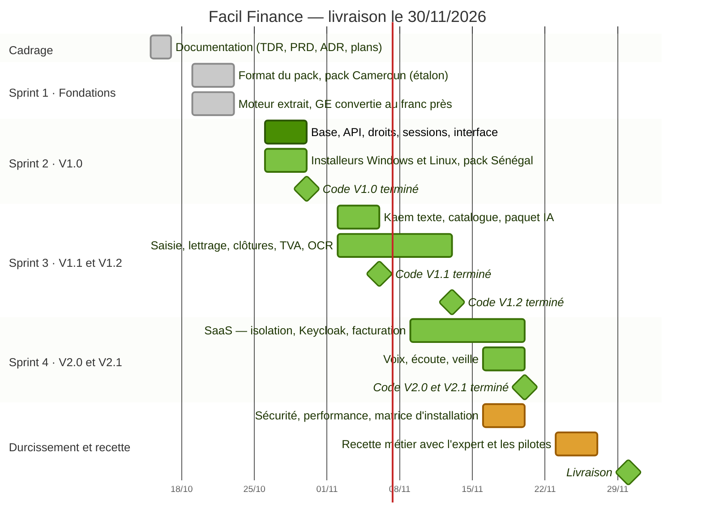
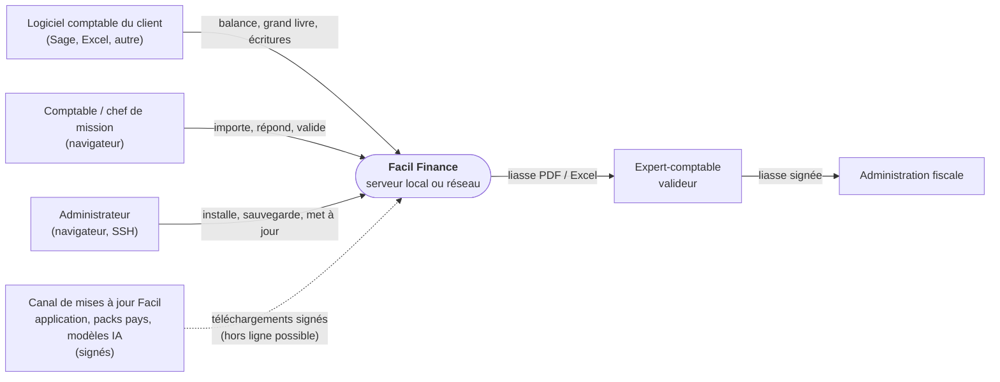
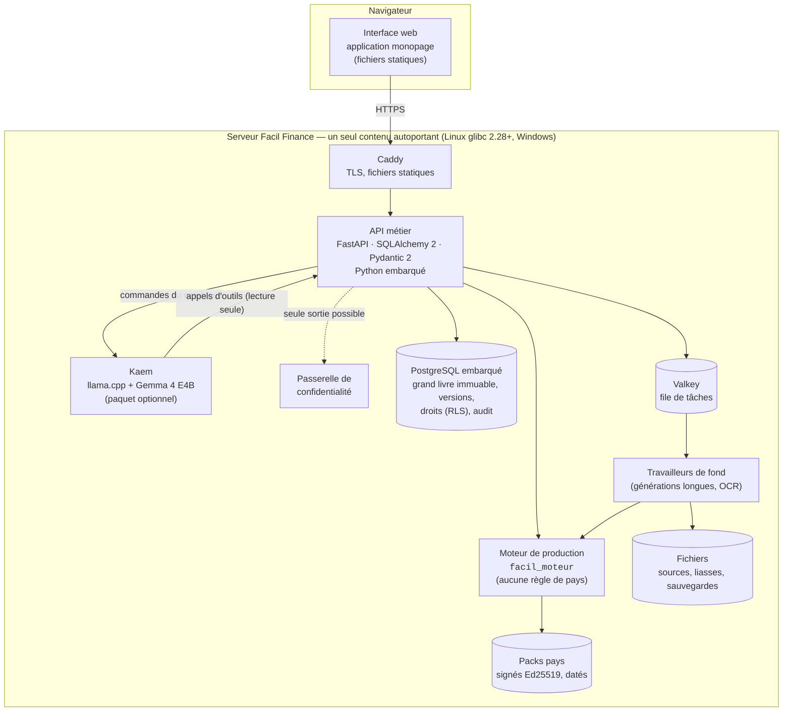
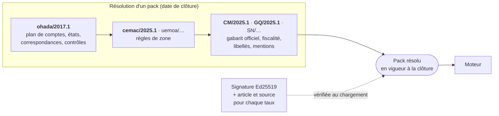
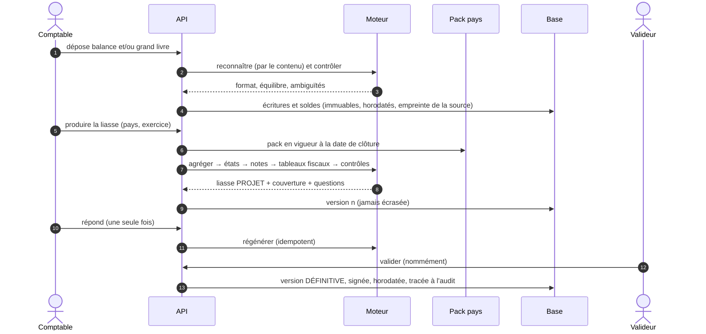
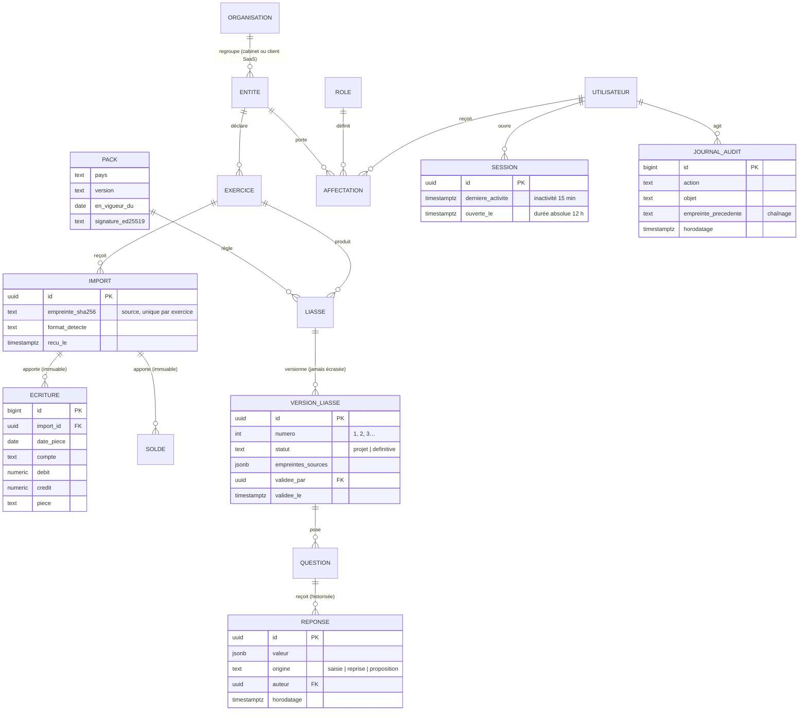
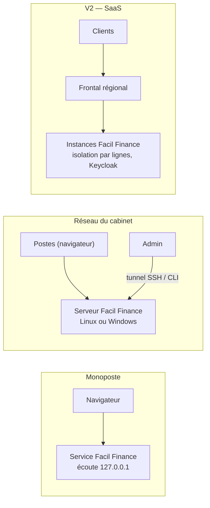
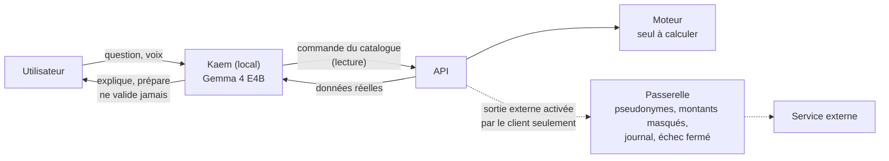
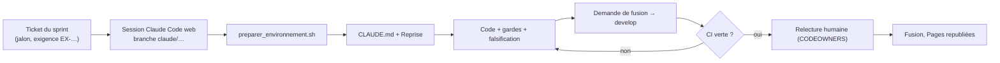
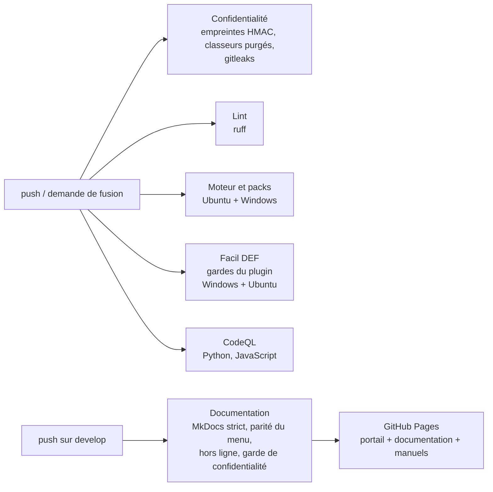

<div align="center">


# Facil Finance

**De la balance à la liasse fiscale validée — SYSCOHADA révisé, 17 États de l'OHADA.**
Calculée sur le poste ou le serveur du client, prouvée chiffre par chiffre, validée par une personne nommée.

[](https://github.com/KouemouSah/Facil_Finance/actions/workflows/ci.yml)
[](https://kouemousah.github.io/Facil_Finance/)
[](https://github.com/KouemouSah/Facil_Finance/actions/workflows/securite.yml)


[**Portail et documentation**](https://kouemousah.github.io/Facil_Finance/) · [Architecture](https://kouemousah.github.io/Facil_Finance/documentation/architecture.html) · [Plan de sprints](https://kouemousah.github.io/Facil_Finance/documentation/plans/sprints.html) · [Tâches](https://github.com/KouemouSah/Facil_Finance/issues) · [Jalons](https://github.com/KouemouSah/Facil_Finance/milestones)

</div>

---

## Sommaire

1. [Ce qu'est Facil Finance](#1-ce-quest-facil-finance)
2. [Où en est le projet](#2-où-en-est-le-projet)
3. [Architecture cible](#3-architecture-cible)
4. [Carte du dépôt](#4-carte-du-dépôt)
5. [Démarrer](#5-démarrer)
6. [Reprendre la construction avec Claude Code web](#6-reprendre-la-construction-avec-claude-code-web)
7. [Chaîne d'intégration et de livraison](#7-chaîne-dintégration-et-de-livraison)
8. [Sécurité et confidentialité](#8-sécurité-et-confidentialité)
9. [Documentation](#9-documentation)
10. [Contribuer, licence](#10-contribuer-licence)

---

## 1. Ce qu'est Facil Finance

Une **plateforme de production financière** pour les cabinets d'expertise comptable et les services comptables des entreprises de l'espace OHADA. Elle lit la balance et le grand livre tels qu'ils sortent du logiciel comptable, produit la **liasse SYSCOHADA** (états, notes, tableaux fiscaux du pays), pose **une seule fois** les questions qu'aucun fichier ne tranche, puis fait **valider** la version définitive par une personne nommée. Rien n'est écrasé, chaque chiffre est relié à ses comptes.

| Principe | Ce qu'il impose |
|---|---|
| **Automatique d'abord, questions ensuite** | La liasse complète est calculée avant la première question |
| **Aucune règle de pays dans le moteur** | Taux, libellés, lignes et contrôles viennent d'un **pack pays** signé et daté |
| **Une liasse se prouve** | Chaque poste relié à ses comptes ; « calculé » ≠ « déclaré » ≠ « prouvé » |
| **Rien n'est écrasé** | Écritures importées, versions de liasse, réponses : horodatées, conservées |
| **Les données restent chez le client** | Serveur local ou réseau ; l'IA (Kaem) est locale ; aucune sortie sans passerelle |
| **L'IA ne calcule ni ne valide** | Kaem explique et prépare ; le moteur calcule ; une personne valide |

**Facil DEF**, déjà livré, en est le premier produit : une extension Claude Desktop qui produit la DSF de Guinée équatoriale (`plugin/compta-ohada`, v0.13.0). Son moteur est la référence métier que Facil Finance réutilise ([ADR 0005](docs/adr/0005-reutiliser-le-moteur-def.md)).

> **Vocabulaire.** En français : **DSF**, Déclaration statistique et fiscale. En espagnol : **DEF**, Declaración Estadística y Fiscal. La marque « Facil DEF » reste telle quelle.

## 2. Où en est le projet

| Livrable | État |
|---|---|
| Cadrage : TDR, PRD (exigences `EX-…`), 14 ADR, registre des risques | fait |
| **Sprint 1 — Fondations** : format du pack pays (validation, signature Ed25519, couches), packs OHADA, CEMAC, Cameroun (préversion), Guinée équatoriale ; noyau du moteur extrait ; IS de la SIC 2025 reproduit au franc près | fait |
| **Facil DEF 0.13.0** : DSF de Guinée équatoriale, lecture **OCR locale** des DSF scannées prouvée par les formules SYSCOHADA, **analyse financière pluriannuelle**, formulaire local, passerelle de confidentialité | livré |
| **Sprint 2 — V1.0 Socle** : base, API, droits, sessions, interface, installeurs, pack Sénégal | [à faire](https://github.com/KouemouSah/Facil_Finance/milestone/1) |

<!-- gantt:debut -->

<!-- gantt:fin -->

Bloc généré depuis la source unique des dates : [`docs/plans/calendrier.yml`](docs/plans/calendrier.yml).

## 3. Architecture cible

Choix arrêtés dans les [ADR](docs/adr/index.md) ; détail dans [l'architecture](docs/architecture.md).

### 3.1 Contexte



Aucun service d'IA externe : **Kaem** tourne en local ([ADR 0007](docs/adr/0007-kaem-ia-locale.md)).

### 3.2 Conteneurs



| Brique | Choix | Écarté, et pourquoi | ADR |
|---|---|---|---|
| API | FastAPI, SQLAlchemy 2, Alembic, Pydantic 2 | — (le moteur est en Python) | [0009](docs/adr/0009-pile-serveur.md) |
| Base | PostgreSQL embarqué | SQLite : ni multi-utilisateurs, ni sécurité au niveau des lignes | [0009](docs/adr/0009-pile-serveur.md) |
| File | Valkey (BSD) | Redis ≥ 7.4 (RSAL/SSPL, incompatible produit fermé) | [0009](docs/adr/0009-pile-serveur.md) |
| Frontal | Caddy | Nginx : TLS manuel | [0009](docs/adr/0009-pile-serveur.md) |
| Interface | Application monopage exportée en statique | Rendu côté serveur : Node.js à l'exécution | [0009](docs/adr/0009-pile-serveur.md) |
| Identité | Intégrée (NIST 800-63B, TOTP) ; Keycloak / OIDC en SaaS | Keycloak partout : 0,5 à 1 Go de mémoire | [0010](docs/adr/0010-identite-selon-edition.md) |
| IA | Gemma 4 E4B local, llama.cpp, sur processeur, 16 Go | IA hébergée : données hors du pays | [0007](docs/adr/0007-kaem-ia-locale.md) |
| Distribution | Contenu autoportant : `.run`, `.deb`, `.rpm`, MSI | Docker obligatoire | [0003](docs/adr/0003-distribution-autoportante.md) |

### 3.3 Packs pays : tout ce qui dépend du pays



Format : [spécification du pack pays](docs/specs/pack-pays.md) ([ADR 0006](docs/adr/0006-packs-pays-declaratifs.md)). Un taux sans article est refusé par la validation.

### 3.4 Flux : de la balance à la liasse validée



### 3.5 Modèle de données cible

Premier livrable du sprint 2 ([EX-IMP-4, EX-PLAT-2](docs/prd.md)) ; ce schéma est le **point de départ**, il s'arrête dans une migration Alembic relue.



Règles portées **par la base**, pas seulement par l'écran : sécurité au niveau des lignes par organisation (prépare le SaaS), écritures et versions définitives en ajout seul (déclencheurs qui refusent `UPDATE` et `DELETE`), journal d'audit chaîné.

### 3.6 Déploiement : un seul logiciel, trois usages



Toujours en mode serveur, même seul ([ADR 0002](docs/adr/0002-toujours-en-mode-serveur.md)) : on change l'adresse d'écoute, on ne réinstalle rien.

### 3.7 Kaem et la frontière de confidentialité



## 4. Carte du dépôt

```text
Facil_Finance/
├── facil_moteur/            moteur : noyau (source unique), format et résolution des packs, adaptateurs
├── packs/                   packs pays : ohada/2017.1, cemac/2025.1, CM/2025.1, GQ/2025.1
├── outils/                  verifier_tout, facil_pack, garde_confidentialite, purger_classeur, portail, conversions
├── tests/                   tests du moteur et des packs (une contre-épreuve par garde)
├── plugin/compta-ohada/     Facil DEF : extension Claude Desktop (skills, serveur MCP, formulaire, OCR, tests)
│                            — runtime/ et dist/ (extension construite) ne sont pas versionnés
├── docs/                    documentation projet (MkDocs) : cadrage, PRD, architecture, ADR, specs, plans
├── manuel/                  manuel, présentation, flyer de Facil DEF (FR « DSF », ES « DEF ») : sources et PDF
├── travaux/                 relevés et recherches de travail (données publiées seulement)
├── .github/                 CI/CD, formulaires de tickets, CODEOWNERS, Dependabot
├── .claude/settings.json    préparation automatique des sessions Claude Code web
└── CLAUDE.md                consignes pour Claude Code (poste et web)
```

Catalogue détaillé : [Catalogue des modules](https://kouemousah.github.io/Facil_Finance/documentation/catalogue-modules.html).

## 5. Démarrer

Prérequis : Python 3.13, git. Jamais de `pip install` dans le Python du système.

```bash
git clone https://github.com/KouemouSah/Facil_Finance.git && cd Facil_Finance
python -m venv .venv && . .venv/bin/activate          # Windows : .venv\Scripts\activate
pip install -r requirements-dev.txt
python outils/installer_crochets.py                   # crochet pre-commit (vérification + confidentialité)

python outils/verifier_tout.py                        # packs + tests + parité noyau ↔ plugin
python outils/facil_pack.py resoudre CM 2025-12-31 --atelier

# Facil DEF (plugin)
pip install -r plugin/compta-ohada/serveur/requirements.txt
pip install --no-deps --ignore-requires-python rapidocr_onnxruntime==1.4.4     # OCR, version figée
python plugin/compta-ohada/tools/gardes_ci.py

# Documentation
pip install -r docs/requirements.txt
python docs/outils/construire_site.py                 # site dans docs/site/
```

L'extension `.mcpb` se construit sous Windows (`plugin/compta-ohada/tools/construire_extension.py`) ; elle n'est **pas** publiée dans ce dépôt.

## 6. Reprendre la construction avec Claude Code web

Le dépôt est conçu pour qu'une session [Claude Code sur le web](https://claude.ai/code) reprenne le travail sans rien redécouvrir.

1. Ouvrir **claude.ai/code**, choisir le dépôt `KouemouSah/Facil_Finance`, branche `develop`.
2. Au démarrage, `.claude/settings.json` lance [`outils/preparer_environnement.sh`](outils/preparer_environnement.sh) : environnement virtuel, dépendances du moteur, du plugin et de la documentation.
3. Claude lit [`CLAUDE.md`](CLAUDE.md) (règles, carte, commandes), puis la section **Reprise** de [`docs/plans/sprints.md`](docs/plans/sprints.md).
4. Demander, par exemple : *« Prends le ticket #… du jalon Sprint 2, fais-le jusqu'à la clôture, ouvre une demande de fusion vers develop. »*
5. La CI rejoue tout ; la demande de fusion porte la preuve en exécution et ce qui n'a pas été vérifié.



Limites déclarées en session web : pas d'Excel ni de Windows (rendu PDF natif, `FACIL_PDF=natif`), pas de construction de l'extension `.mcpb`, et **la garde nominative de confidentialité ne joue qu'avec la clé** (secret de CI) : en session web, c'est la CI qui la tient.

## 7. Chaîne d'intégration et de livraison



| Workflow | Déclencheurs | Rôle |
|---|---|---|
| [`ci.yml`](.github/workflows/ci.yml) | push, demande de fusion | confidentialité, lint, moteur (Ubuntu, Windows), plugin (Windows, Ubuntu) |
| [`documentation.yml`](.github/workflows/documentation.yml) | push sur `develop`, chaque lundi, manuel | construit et publie le portail et la documentation |
| [`securite.yml`](.github/workflows/securite.yml) | push, demande de fusion, chaque lundi | CodeQL |
| [`dependabot.yml`](.github/dependabot.yml) | chaque semaine | actions et dépendances Python (l'OCR reste figé) |

Branches : `develop` (par défaut, intégration) et `main` (versions `vX.Y.Z`), toutes deux protégées. Détail : [CONTRIBUTING](CONTRIBUTING.md).

## 8. Sécurité et confidentialité

- **Aucune donnée de client dans ce dépôt public.** La liste des noms confidentiels reste hors dépôt ; seules ses **empreintes HMAC** y sont, inexploitables sans la clé (secret de CI). Classeurs purgés de leurs liaisons externes et de leurs auteurs ([`outils/purger_classeur.py`](outils/purger_classeur.py)).
- **Packs signés** Ed25519 ; la clé privée n'est jamais dans le dépôt.
- **Facil DEF** : formulaire local `127.0.0.1` protégé par jeton, sessions à deux horloges (15 min, 12 h), passerelle de confidentialité (pseudonymes, montants masqués, journal des sorties).
- Signaler une vulnérabilité : [SECURITY.md](SECURITY.md), jamais en ticket public.

## 9. Documentation

| Où | Quoi |
|---|---|
| [Portail](https://kouemousah.github.io/Facil_Finance/) | Tableau de bord (jalons, tâches), accès, manuels |
| [Documentation projet](https://kouemousah.github.io/Facil_Finance/documentation/) | Cadrage, PRD, architecture, ADR, spécifications, plans, catalogue des modules, Facil DEF, exploitation |
| [`docs/`](docs/) | Sources Markdown du site |
| [`manuel/livrable/`](manuel/livrable/) | Manuel d'utilisation, présentation, flyer de Facil DEF (FR et ES) |

## 10. Contribuer, licence

- [CONTRIBUTING](CONTRIBUTING.md) : branches, commits, définition de « fait ». [Code de conduite](CODE_OF_CONDUCT.md).
- **Licence propriétaire** ([LICENSE](LICENSE)) : le dépôt est public pour la transparence ; il ne vaut pas licence d'utilisation ([ADR 0011](docs/adr/0011-licence-proprietaire.md)).

<sub>© Emac SAH — Facil - AI Solutions Architect · SIRET 108 750 407 00018 · Paris, France · sah@emacsah.com</sub>
