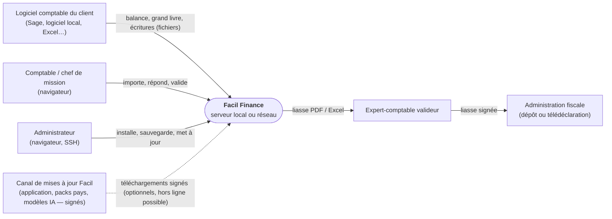
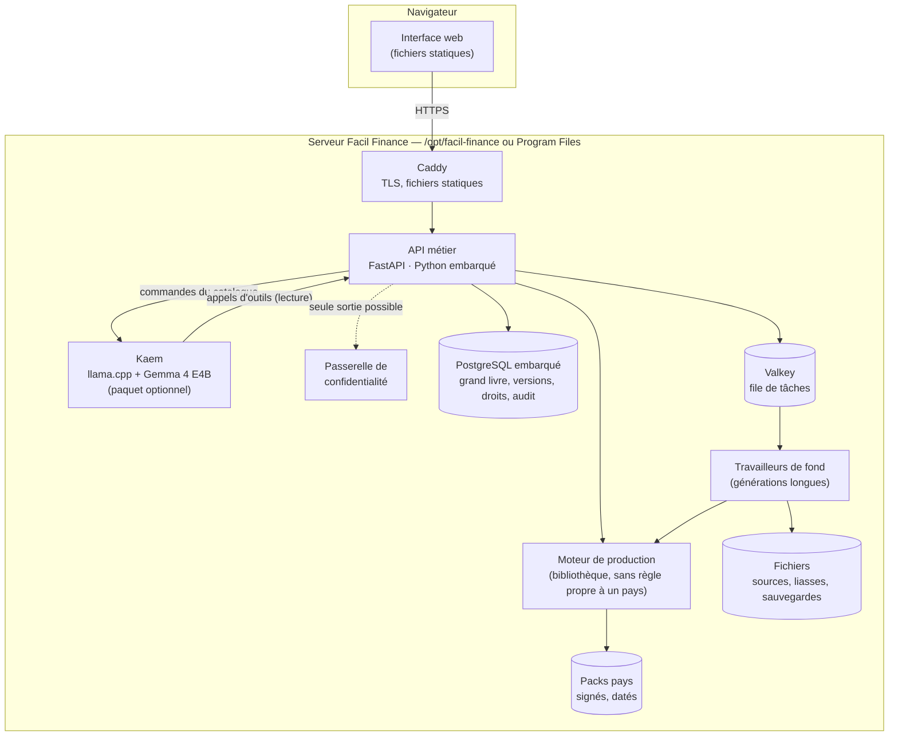
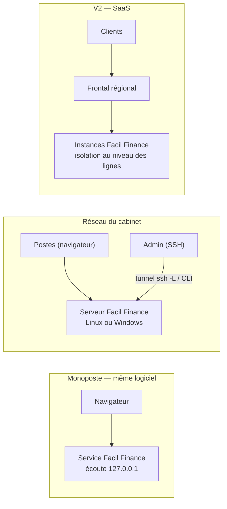
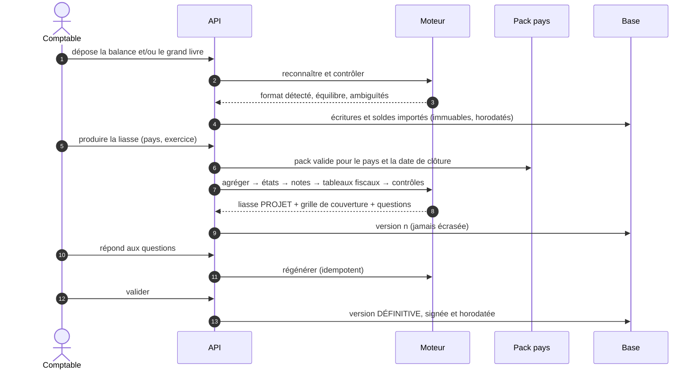

# Architecture — vue d'ensemble

brouillon · Version 0.1 · 15/10/2026

Cette page donne les vues C4 (contexte, conteneurs), le déploiement et le flux de production d'une liasse. Chaque choix renvoie à son [ADR](adr/index.md).

## 1. Contexte (C4 — niveau 1)

**Ce qui ne figure pas sur ce schéma est voulu** : aucun service d'IA externe. Kaem fonctionne en local ([ADR 0007](adr/0007-kaem-ia-locale.md)). Un appel externe ne peut être activé que par le client, à travers la passerelle de confidentialité.

## 2. Conteneurs (C4 — niveau 2)

| Conteneur | Rôle | Décision |
|---|---|---|
| Caddy | TLS (certificat automatique ou autorité locale), fichiers statiques | [ADR 0009](adr/0009-pile-serveur.md) |
| API métier | Droits, orchestration, contrats OpenAPI | [ADR 0009](adr/0009-pile-serveur.md) |
| Moteur | Lecture des balances, agrégation, états, contrôles, rendu Excel et PDF | [ADR 0005](adr/0005-reutiliser-le-moteur-def.md) |
| Packs pays | Tout ce qui dépend du pays | [ADR 0006](adr/0006-packs-pays-declaratifs.md) |
| PostgreSQL | Grand livre immuable, versions de liasse, droits, journal d'audit | [ADR 0004](adr/0004-erp-entree-par-la-production.md) |
| Kaem | Assistante locale | [ADR 0007](adr/0007-kaem-ia-locale.md), [ADR 0008](adr/0008-ia-ne-calcule-ni-ne-valide.md) |

## 3. Déploiement

**Le même logiciel** sert ces trois cas ([ADR 0002](adr/0002-toujours-en-mode-serveur.md)). Seules l'adresse d'écoute et la configuration changent.

## 4. Flux : de la balance à la liasse

## 5. Principes non négociables

1. **Le moteur ne contient aucune règle propre à un pays** : chaque taux, libellé, ligne et contrôle vient d'un pack.
2. **Une liasse se prouve** : chaque poste est relié à ses comptes ; chaque contrôle est consigné ; chaque écart est expliqué.
3. **Rien n'est écrasé** : écritures importées, versions de liasse et réponses sont horodatées et conservées.
4. **Les droits sont tenus par la base**, pas seulement par l'écran.
5. **Aucune sortie sans passerelle** : tout ce qui quitte le serveur est pseudonymisé, contrôlé et journalisé.
