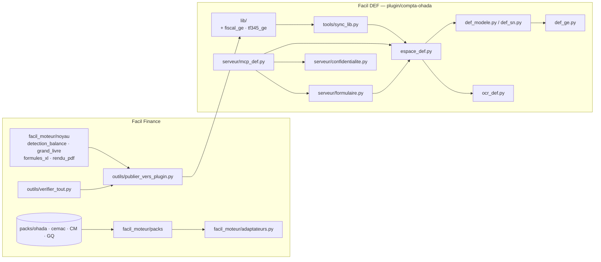

# Catalogue des modules

brouillon · Version 0.1 · 20/10/2026

Le dépôt porte deux bases de code. Le **moteur** `facil_moteur` et ses **packs pays** (`packs/`) forment
Facil Finance ; le plugin `plugin/compta-ohada` est **Facil DEF**, le produit livré, qui reste la
référence métier tant que le moteur ne l'a pas entièrement repris.

!!! warning "Source unique du noyau"
    Le noyau se modifie **uniquement** dans `facil_moteur/noyau/`. `outils/publier_vers_plugin.py` le
    copie dans le plugin, puis `plugin/compta-ohada/tools/sync_lib.py` redistribue `lib/` vers les
    skills. Une garde de parité (`publier_vers_plugin.py --check`, `sync_lib.py --check`) rougit dès
    qu'une copie diverge. Ne jamais corriger une copie.

## Vue d'ensemble des dépendances

## Moteur — noyau

Modules sans aucune règle propre à un pays (`facil_moteur/noyau/`). Ils sont publiés à l'identique
dans le plugin.

| Module | Rôle | Points d'entrée |
| --- | --- | --- |
| `facil_moteur/__init__.py` | Paquet du moteur : lecture des balances et grands livres, agrégation, états, contrôles, rendu ; les règles pays viennent des packs | — |
| `facil_moteur/noyau/detection_balance.py` | Détecte une balance comptable quelconque (xls, xlsx) par **invariants comptables** : colonnes, séparateur décimal, comptes | `read_sheets`, `analyse`, `analyse_grid`, `invariants`, `rapport` |
| `facil_moteur/noyau/grand_livre.py` | Lit un grand livre quelconque (xls/xlsx/csv) par la structure de ses lignes ; reconstitue la balance, rapproche, repère les pièces de clôture | `lire`, `balance_reconstituee`, `soldes`, `rapprocher`, `pieces_de_cloture` |
| `facil_moteur/noyau/formules_xl.py` | Évaluateur des formules que le moteur écrit dans ses classeurs — remplace le recalcul par Excel | `Evaluateur`, `evaluer_classeur`, `FormuleNonSupportee` |
| `facil_moteur/noyau/rendu_pdf.py` | Rendu PDF natif d'un classeur mis en page (PyMuPDF), sans Excel | `classeur_vers_pdf`, `feuille_html` |

Publication dans le plugin (table `DESTINATIONS` de `publier_vers_plugin.py`) :

| Module du noyau | Copie dans le plugin |
| --- | --- |
| `detection_balance.py` | `plugin/compta-ohada/lib/detection_balance.py` |
| `grand_livre.py` | `plugin/compta-ohada/lib/grand_livre.py` |
| `rendu_pdf.py` | `plugin/compta-ohada/lib/rendu_pdf.py` |
| `formules_xl.py` | `plugin/compta-ohada/skills/dsf-syscohada/scripts/formules_xl.py` |

## Moteur — packs

| Module | Rôle | Points d'entrée |
| --- | --- | --- |
| `facil_moteur/packs/__init__.py` | Chargement, validation, signature (clés embarquées) et résolution des couches d'un pack pays ; période de vigueur ; poste d'un compte | `charger`, `valider`, `signer`, `verifier_signature`, `resoudre`, `PackResolu`, `en_vigueur`, `poste_du_compte` |
| `facil_moteur/adaptateurs.py` | Rend aux calculs du moteur les données d'un pack résolu, au format qu'ils attendent | `parametres_fiscaux` |

## Outils du dépôt

Scripts de `outils/`, lancés à la main ou par le crochet `pre-commit`.

| Module | Rôle | Points d'entrée |
| --- | --- | --- |
| `outils/verifier_tout.py` | Recette unique avant commit : validation des packs, `pytest`, parité noyau ↔ plugin (sautée si le plugin est absent) ; code 1 si une étape échoue | `python outils/verifier_tout.py` |
| `outils/installer_crochets.py` | Installe le crochet git `pre-commit` (vérification complète + garde de confidentialité) | `main` |
| `outils/facil_pack.py` | Outil interne des packs : `valider`, `valider-tout`, `signer`, `resoudre`, `generer-cle` | `cmd_valider`, `main` |
| `outils/publier_vers_plugin.py` | Copie le noyau dans le plugin puis lance `sync_lib.py` ; `--check` : code 1 si une copie diverge | `ecarts`, `main` |
| `outils/garde_confidentialite.py` | Garde du dépôt public : aucun nom de client, coordonnée ou compte bancaire (empreintes HMAC, classeurs et PDF compris) | `controler`, `regenerer`, `main` |
| `outils/purger_classeur.py` | Purge un `.xlsx` de ce qu'il transporte sans qu'on le voie : liaisons externes, noms définis cachés, auteurs | `diagnostic`, `purger`, `main` |
| `outils/convertir_ge.py` | Convertit la Guinée équatoriale (codée dans le plugin) au format pack | `main` |
| `outils/convertir_references.py` | Construit les couches communes des packs depuis les références du plugin (règles de comptes, correspondances SN) | `regles_comptes`, `correspondances_sn`, `main` |
| `outils/comparer_formulaires.py` | Compare deux formulaires Excel de liasse (feuilles, libellés, formules) pour choisir le gabarit d'un pack | `comparer`, `rapport`, `main` |
| `outils/positions_postes.py` | Compare la position des postes (codes REF : AD, BH, XI…) entre deux formulaires | `positions`, `main` |
| `outils/lignes_notes.py` | Vérifie que chaque ligne de note écrite par le moteur porte le même libellé dans un autre formulaire | `main` |
| `outils/lire_dsf_pdf.py` | Relève, page par page, les lignes « code de poste + montants » d'une DSF publiée en PDF texte | `relever`, `main` |

## Packs pays

Un pack est un dossier `packs/<pays|zone>/<version>/` ; les couches s'empilent par `herite_de`.

| Pack | Contenu |
| --- | --- |
| `packs/ohada/2017.1` | Couche commune OHADA : `controles.json`, `declencheurs.json`, `correspondances/{comptes,postes,sn}.json`, gabarit `gabarits/sn.xlsx` |
| `packs/cemac/2025.1` | Couche zone CEMAC : manifeste et sources seulement |
| `packs/CM/2025.1` | Cameroun : `fiscal/parametres.json`, `correspondances/smt.json`, libellés `en`/`fr`, `verifications/formulaire-officiel.md` |
| `packs/GQ/2025.1` | Guinée équatoriale, détaillé ci-dessous |

Fichiers de `packs/GQ/2025.1` :

| Fichier | Ce qu'il porte |
| --- | --- |
| `pack.yaml` | Manifeste : pays, version, période de vigueur (`valide_du` / `valide_au`), monnaie, langues de liasse (`es`, `fr`), systèmes (`SN`, `SMT`), `herite_de` (`ohada/2017.1`, `cemac/2025.1`), statut, bloc `validation` (expert, date, liasses reproduites), `moteur_minimal`, renvoi au gabarit |
| `SOURCES.md` | Textes officiels sur lesquels reposent les paramètres |
| `CHANGELOG.md` | Historique des versions du pack |
| `fiscal/parametres.json` | Paramètres fiscaux (taux, seuils), chacun avec son article |
| `gabarits/def_ge.xlsx` | Gabarit vierge de la liasse au format GE |
| `structure/def_ge.json` | Structure du gabarit (feuilles, lignes, rôles des colonnes) |
| `structure/i18n-def.json` | Traductions FR ↔ ES des libellés de la liasse |
| `libelles/fr.json`, `libelles/es.json` | Libellés d'interface du pack |

## Facil DEF — bibliothèque partagée (lib)

`plugin/compta-ohada/lib/` est la source des modules partagés **entre skills** ; `tools/sync_lib.py`
les copie dans `skills/<skill>/scripts/` (table `PARTAGES`). Les trois premiers sont eux-mêmes des
copies du noyau du moteur.

| Module | Rôle | Points d'entrée |
| --- | --- | --- |
| `lib/detection_balance.py` | Copie du noyau (voir ci-dessus) ; distribuée à `dsf-syscohada`, `revision-comptes-ohada`, `fiscalite-guinee-equatoriale` | `analyse`, `rapport` |
| `lib/grand_livre.py` | Copie du noyau ; distribuée à `dsf-syscohada`, `fiscalite-guinee-equatoriale` | `lire`, `balance_reconstituee` |
| `lib/rendu_pdf.py` | Copie du noyau ; distribuée à `dsf-syscohada`, `redaction-comptable-pro` | `classeur_vers_pdf` |
| `lib/fiscal_ge.py` | Moteur fiscal GE : TF1 (résultat fiscal) et TF2 (IS / Cuota Mínima Fiscal), propositions, questions, versements, échéances ; chaque paramètre cité | `load_params`, `calculer`, `propositions`, `questions_entree`, `echeances`, `ecrire_xlsx` |
| `lib/parametres_fiscaux_ge.json` | Paramètres fiscaux GE lus par `fiscal_ge.py` | — |
| `lib/tf345_ge.py` | TF3 (IVA annuelle), TF4 (salaires), TF5 (paiements aux tiers), depuis le grand livre | `tf3`, `tf4`, `tf5`, `calculer`, `ecrire_xlsx` |

## Facil DEF — production de la DSF (scripts du skill dsf-syscohada)

Dossier `plugin/compta-ohada/skills/dsf-syscohada/scripts/`. Les copies de `lib/` et du noyau
(`detection_balance`, `grand_livre`, `rendu_pdf`, `fiscal_ge`, `tf345_ge`, `formules_xl`) n'y sont pas
répétées.

| Module | Rôle | Points d'entrée |
| --- | --- | --- |
| `espace_def.py` | **Dossier de travail** de la DSF : inventaire et rôle des fichiers déposés, génération automatique, questions, validation explicite ; orchestre tous les autres | `init`, `inventaire`, `role_du_fichier`, `racine_defaut`, `lire_json`, `ecrire_json` |
| `def_modele.py` | DSF « modèle officiel » : reproduit feuille pour feuille la structure GE (51 feuilles), en français et en espagnol, montants recalculés ; élague les notes néant | `Generateur`, `produire`, `exporter_pdf`, `notes_neant`, `elaguer_notes` |
| `def_sn.py` | DSF sur le modèle SYSCOHADA révisé, système normal (formulaire officiel), adaptée à la Guinée équatoriale et aux données de l'entité | `ProducteurSN`, `correspondance`, `copier_feuille` |
| `def_ge.py` | Calcul de la DSF GE (système normal) : lecture, note 3, tableau des flux, écriture du classeur, export PDF | `calculer`, `note3`, `tft`, `ecrire_xlsx`, `exporter_pdf`, `main` |
| `agreger_balance_dsf.py` | Agrège une balance SYSCOHADA vers les postes (REF) de la DSF selon la correspondance comptes → postes | `read_balance`, `load_mapping`, `aggregate`, `main` |
| `identite_sources.py` | Lit l'identité de l'entité dans les sources déposées (DSF précédente, fiche entité) pour ne pas la redemander | `extraire`, `depuis_def`, `depuis_fiche` |
| `ocr_def.py` | Lecture locale d'une DSF scannée (PDF images) : bilan et compte de résultat, colonnes N et N-1 (RapidOCR, OpenCV) | `disponible`, `relire`, `cases`, `lignes_actif` |
| `controle_def.py` | Rapport de contrôle interne de la DSF (A4, par sections), jamais déposé | `construire` |
| `rapport_def.py` | Rapport PDF de la DSF, distinct de l'impression de la liasse | `construire`, `recalculer`, `extraire` |
| `analyse_financiere.py` | Rapport d'analyse financière pluriannuel (N, N-1, N-2… selon les sources), interne | `construire`, `ratios`, `variations`, `annees_depuis` |
| `classer_documents.py` | Classifie les fichiers fournis (rôle détecté) pour ne pas imposer de format | `inspect`, `classify`, `main` |
| `extraire_donnees.py` | Lit les données extra-comptables (clé-valeur) et les formalise vers `besoin-extra-comptable.json` | `extract`, `main` |
| `monter_dsf.py` | Orchestrateur en ligne de commande « fichiers → DSF » | `gather_files`, `classify_all`, `main` |

Le skill porte aussi `references/` (correspondances, squelette de liasse) et `templates/`
(`def_ge_gabarit.xlsx` + `.json`, `syscohada_sn_modele.xlsx`).

## Facil DEF — serveur MCP et formulaire

Dossier `plugin/compta-ohada/serveur/`. Déclaré dans `.mcp.json` (serveur `facil-def`, lancé par
`runtime/python.exe`) ; empaqueté pour Claude Desktop depuis `extension/manifest.json`.

| Module | Rôle | Points d'entrée |
| --- | --- | --- |
| `serveur/mcp_def.py` | Serveur MCP « facil-def » : la DSF GE depuis le dossier de travail local ; précharge les bibliothèques natives avant `mcp.run()` | `precharger`, décorateur `protege` |
| `serveur/confidentialite.py` | Passerelle de confidentialité : ce qui part vers le modèle est pseudonymisé, vérifié (échec fermé) et journalisé | `Passerelle`, `Coffre`, `MODE` |
| `serveur/formulaire.py` | Formulaire web local (127.0.0.1) : répondre, régénérer, valider sans passer par la conversation ; inactivité 15 min, durée 12 h | `Serveur`, `Gestionnaire`, `demarrer` |
| `serveur/garde_lecture.py` | Hook `PreToolUse` : Claude ne lit ni n'écrit le dossier Facil-DEF par ses outils généraux | `main`, `refuse` |
| `serveur/lancer.py` | Lanceur de l'environnement isolé du serveur (bibliothèque standard seule) | `installer`, `pret`, `main` |
| `serveur/requirements*.txt` | Dépendances du serveur, et de l'OCR à part | — |

Outils MCP exposés (tous passent par `protege`) :

| Outil | Ce qu'il fait |
| --- | --- |
| `dossier_travail(entite, exercice)` | Crée ou retrouve le dossier de travail et liste les fichiers déposés avec leur rôle reconnu |
| `lister_dossiers()` | Entités et exercices présents, avec la dernière version et son statut |
| `generer_def(entite, exercice, pdf)` | Génère une nouvelle version PROJET (classeurs FR/ES, PDF, annexe balance, contrôle) et consolide les questions |
| `questions_ouvertes(entite, exercice, facultatives)` | Questions sans réponse, avec catégorie, type, choix permis et impact |
| `enregistrer_reponse(entite, exercice, id, valeur)` | Enregistre une réponse contrôlée (hors des choix permis : refus) |
| `valider_version(entite, exercice, par)` | Produit la version DÉFINITIVE si aucune question obligatoire n'est ouverte et si les sources n'ont pas changé |
| `ouvrir_formulaire(entite, exercice, navigateur)` | Ouvre le formulaire web local et rend un nouveau lien d'accès |

## Facil DEF — skills métier

`plugin/compta-ohada/skills/<nom>/SKILL.md`, avec `scripts/` quand le skill calcule.

| Skill | Rôle (d'après sa description) | Scripts |
| --- | --- | --- |
| `dsf-syscohada` | Montage assisté de la DSF (liasse SYSCOHADA révisé) depuis la balance après inventaire et les sous-livres | voir section dédiée |
| `fiscalite-guinee-equatoriale` | Fiscalité d'entreprise GE (IS, IVA, retenues, obligations déclaratives, DSF) | `calcul_is_ge.py`, `calcul_tf345_ge.py` + copies de `lib/` |
| `etats-financiers-ohada` | Bilan, compte de résultat, flux de trésorerie, notes, SIG | — |
| `revision-comptes-ohada` | Revue analytique N/N-1, cohérence de balance, justification de soldes | `dossier_revision.py` |
| `cloture-comptable-ohada` | Clôture : checklist d'inventaire, écritures de régularisation, provisions | — |
| `immobilisations-ohada` | Plans d'amortissement et registre d'immobilisations (livrables Excel) | `amortissement.py`, `registre_immobilisations.py` |
| `comptabilite-chantier-btp` | Avancement, situations de travaux, perte à terminaison | `avancement.py`, `situation_travaux.py` |
| `analyse-financiere-btp` | Ratios, BFR, trésorerie prévisionnelle, contrôle budgétaire | `ratios.py` |
| `tresorerie-rapprochement-bancaire` | Rapprochement bancaire, cautions, caisses de chantier | — |
| `audit-controle-interne-ohada` | Programmes d'audit par cycle, constats FRAP, cartographie des risques | — |
| `reporting-financier` | Rapports de direction et de comité | `xlsx_to_table.py` |
| `redaction-comptable-pro` | Notes, mémos, courriers ; Markdown → PDF A4 | `md_vers_pdf.py` + copie de `rendu_pdf.py` |
| `excel-comptable` | Aide Excel et VBA pour le comptable | — |
| `presentation-decks` | Présentations HTML « deck » | — |

Autour des skills :

| Dossier | Contenu |
| --- | --- |
| `commands/` | 14 commandes : `monter-dsf` (génère la DSF GE depuis le dossier de travail), `dsf`, `amortissement`, `avancement`, `cloture`, `controle-balance`, `note`, `rapport`, `rapprochement`, `ratios`, `revue-analytique`, `sig`, `situation-travaux`, `suivi-audit` |
| `hooks/hooks.json` | `PreToolUse` sur `Read`, `Grep`, `Glob`, `Bash`, `PowerShell`, `Notebook*`, `Edit`, `Write` → `serveur/garde_lecture.py` |
| `agents/` | `deck-builder.md` |

## Facil DEF — outils

`plugin/compta-ohada/tools/`, lancés à la main : `python tools/<script>.py`.

| Module | Rôle | Points d'entrée |
| --- | --- | --- |
| `tools/sync_lib.py` | Copie `lib/` vers les skills consommateurs ; n'écrase qu'un fichier portant la marque `compta-ohada/lib/` ; `--check` | `main` |
| `tools/package.py` | Valide `plugin.json` et le frontmatter des skills, régénère les templates, contrôle les noms interdits, produit `dist/compta-ohada.zip` | `validate`, `package`, `noms_interdits` |
| `tools/build_templates.py` | Génère (idempotent) les templates Excel des skills | `build_*` |
| `tools/construire_runtime.py` | Construit le Python embarqué Windows et ses dépendances dans `runtime/` | `main` |
| `tools/construire_extension.py` | Construit l'extension Claude Desktop (`.mcpb`) du serveur `facil-def` | `main` |
| `tools/construire_gabarit.py` | Construit le gabarit vierge embarqué de la DSF GE, purgé, depuis une DSF déposée | `structure_prouvee`, `purger`, `main` |
| `tools/construire_correspondance_sn.py` | Construit la correspondance « ligne du modèle SN → comptes » depuis le format GE | `main` |
| `tools/comparer_modeles.py` | Compare le modèle SN officiel et le format GE, note par note et ligne par ligne | `main` |
| `tools/extract_dsf_skeleton.py` | Extrait le squelette de la liasse (bilan, compte de résultat, index des notes) en référence Markdown | `main` |
| `tools/gen_mapping_md.py` | Génère `references/mapping-comptes-dsf.md` depuis le JSON source | `render`, `main` |
| `tools/gardes_sur_runtime.py` | Rejoue toutes les gardes `tests/test_*.py` avec le Python embarqué seul | `main` |

## Tests et contre-épreuves

**Moteur** (`tests/`, `pytest`, lancés par `verifier_tout.py`) :

| Test | Ce qu'il garde |
| --- | --- |
| `tests/test_noyau.py` | Noyau importable en paquet, et parité avec le plugin (avec contre-épreuve) |
| `tests/test_packs.py` | Format des packs : chaque règle de validation a sa mutation (manifeste, couches, paramètres, signature) |
| `tests/test_pack_ge.py` | Pack GQ : mêmes paramètres et mêmes calculs fiscaux que le plugin, au franc près |
| `tests/test_demo_*.py` | Pack CM appliqué à une DSF publiée : contrôles OHADA, résultat fiscal, impôt reproduit |
| `tests/test_garde_confidentialite.py` | Garde de confidentialité éprouvée des deux côtés |

**Facil DEF** (`plugin/compta-ohada/tests/`) : scripts autonomes, sans `pytest`, lancés un par un
(`python tests/test_x.py`, code 0 = conforme). Chaque garde a sa **falsification**
(`python tests/falsification_x.py` ou `tests/falsifier_x.py`) qui applique une mutation par règle
protégée à une copie du plugin ; code 0 = toutes les mutations détectées.

| Garde | Module gardé | Falsification |
| --- | --- | --- |
| `test_detection_balance.py` | `detection_balance` et ses consommateurs | `falsification_detection.py` |
| `test_mapping_dsf.py` | correspondance comptes → postes, `agreger_balance_dsf` | `falsification_mapping.py` |
| `test_fiscal_ge.py` | `fiscal_ge` (TF1/TF2, attendus calculés à la main) | `falsification_fiscal.py` |
| `test_tf345_ge.py` | `grand_livre`, `tf345_ge` | `falsification_tf345.py` |
| `test_grand_livre_seul.py` | entrée « grand livre seul » | `falsification_grand_livre_seul.py` |
| `test_def_ge.py` | `def_ge` | `falsification_def.py` |
| `test_def_modele.py` | `def_modele` | `falsification_def_modele.py` |
| `test_sn.py` | `def_sn` | `falsification_sn.py` |
| `test_gabarit.py` | gabarit vierge embarqué | `falsification_gabarit.py` |
| `test_formules_xl.py`, `test_rendu_pdf.py` | évaluateur de formules, rendu PDF | `falsification_rendu.py` |
| `test_espace_def.py` | dossier de travail | `falsification_espace_def.py` |
| `test_confidentialite.py` | passerelle et hook de lecture | `falsification_confidentialite.py` |
| `test_formulaire.py` | formulaire web (accès, réponses, deux horloges) | `falsification_formulaire.py` |
| `test_formulaire_parcours.py`, `test_formulaire_reel.py` | parcours complet du formulaire | `falsifier_formulaire_parcours.py` |
| `test_reprise_validation.py` | DSF précédente, identité reprise, préparer et valider | `falsifier_reprise_validation.py` |
| `test_ocr_def.py` | `ocr_def`, sur un scan de vérité connue (`fabriquer_scan.py`) | `falsifier_ocr_def.py` |
| `test_analyse_financiere.py` | `analyse_financiere` | `falsifier_analyse_financiere.py` |
| `test_mcp_def.py` | serveur MCP de bout en bout par un vrai client (stdio, environnement isolé) | — |
| `test_racine.py` | dossier de travail : une valeur mal transmise n'est jamais un chemin | — |
| `test_garde_empaquetage.py` | `package.py` : noms interdits | — |

Utilitaire : `tests/serveur_demo_navigateur.py` garde le formulaire ouvert pour un essai dans un vrai
navigateur.
