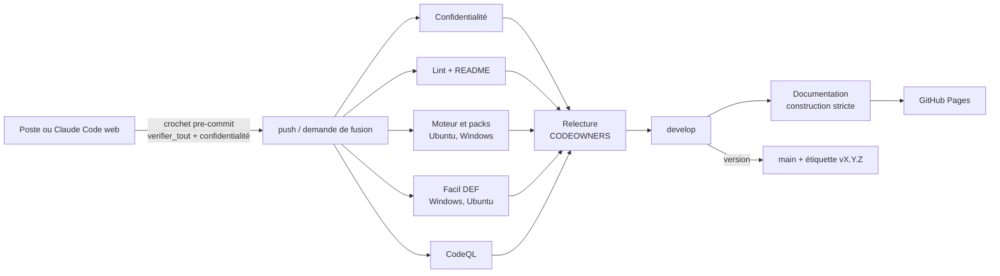

# Chaîne d'intégration et de livraison

en place · Version 0.1 · 20/10/2026

Tout ce qui entre dans `develop` a été rejoué par la CI ; tout ce que publie GitHub Pages a passé les gardes de la documentation et de confidentialité. Les workflows sont dans [`.github/workflows/`](https://github.com/KouemouSah/Facil_Finance/tree/develop/.github/workflows).

## 1. Vue d'ensemble

## 2. Les workflows

| Workflow | Tâche | Ce qui le fait échouer |
|---|---|---|
| `ci.yml` · Confidentialité | `garde_confidentialite.py --exiger-cle`, `purger_classeur.py --verifier`, gitleaks | un nom confidentiel, un courriel, un IBAN, un téléphone hors liste blanche ; un classeur non purgé ; un secret ; **la clé absente** sur une branche du dépôt |
| `ci.yml` · Lint | `ruff check` (syntaxe, noms indéfinis), `maj_readme.py --check` | une erreur de syntaxe ; un README divergent du calendrier |
| `ci.yml` · Moteur | `verifier_tout.py` sur Ubuntu et Windows | un pack invalide ou mal signé ; un test rouge ; le noyau du plugin différent de la source |
| `ci.yml` · Facil DEF | `tools/gardes_ci.py` sur Windows (22 gardes) et Ubuntu (19 : trois éprouvent un comportement propre à Windows et y sont **déclarées**, motif imprimé, ticket #39) | une garde rouge ; une garde qui dépasse son délai (gel) |
| `documentation.yml` | `construire_site.py`, `construire_portail.py`, garde sur le site construit, publication | lien cassé (mode strict) ; page hors menu ; ressource chargée depuis Internet ; donnée confidentielle |
| `securite.yml` | CodeQL Python et JavaScript, chaque lundi | alerte de sécurité nouvelle (onglet *Security*) |
| Dependabot | Actions et dépendances Python, chaque semaine | — (propose des demandes de fusion) |

## 3. Gardes, et la preuve qu'elles gardent

Une garde verte ne prouve rien tant qu'on ne l'a pas vue rougir. Chacune a sa contre-épreuve :

| Garde | Contre-épreuve |
|---|---|
| Confidentialité (`outils/garde_confidentialite.py`) | `tests/test_garde_confidentialite.py` : nom planté (casse, accents, classeur) attrapé ; texte propre accepté ; une autre clé ne reconnaît rien |
| Parité du noyau | `outils/publier_vers_plugin.py --check` ; une copie modifiée dans le plugin rougit |
| Packs | `tests/test_packs.py` : taux sans article, signature altérée, couche manquante |
| Facil DEF | `plugin/compta-ohada/tests/falsifi*.py`, une mutation par garde |
| Documentation | `docs/outils/contre_epreuves.py` |

## 4. Publication de la documentation

Le site est assemblé à chaque poussée sur `develop`, et chaque lundi pour rafraîchir le tableau de bord :

| Chemin publié | Contenu | Construit par |
|---|---|---|
| `/` | Portail : indicateurs, jalons, tâches récentes, accès | `outils/construire_portail.py` (API GitHub) |
| `/documentation/` | Ce site | `docs/outils/construire_site.py` (MkDocs) |
| `/manuels/` | Manuels et supports de Facil DEF, FR et ES | copiés depuis `manuel/livrable/` |

Les manuels PDF sont construits sur un poste Windows (Word, PowerPoint et Edge pour un rendu fidèle) et versionnés ; la CI ne les régénère pas.

## 5. Ce qui ne se publie jamais

L'extension construite (`.mcpb`, `runtime/`, `dist/`), les données des clients et le dossier `datas/`, les captures non masquées, les clés. Le `.gitignore` les écarte ; la garde de confidentialité et gitleaks rattrapent ce qui passerait.

## 6. Versions

`develop` est fusionnée dans `main` à chaque version livrée, étiquetée `vX.Y.Z`, avec son entrée au [CHANGELOG](https://github.com/KouemouSah/Facil_Finance/blob/develop/CHANGELOG.md). L'extension Facil DEF garde sa propre numérotation (0.13.x).
