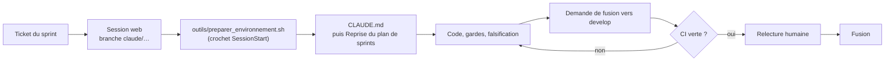

# Démarrer

<span class="statut statut--valide">à jour</span> · Version 0.1 · 20/10/2026

Cette page installe un poste de développement, rejoue toutes les vérifications, et explique comment une session **Claude Code sur le web** reprend le travail. Elle suppose le dépôt [`KouemouSah/Facil_Finance`](https://github.com/KouemouSah/Facil_Finance).

## 1. Le dépôt en une minute

| Dossier | Ce qu'on y trouve | Page de référence |
|---|---|---|
| `facil_moteur/` | Moteur : noyau (source unique), packs, adaptateurs | [Catalogue des modules](catalogue-modules.md) |
| `packs/` | Packs pays signés et datés | [Format du pack pays](specs/pack-pays.md) |
| `plugin/compta-ohada/` | Facil DEF, l'extension livrée | [Facil DEF](facil-def.md) |
| `docs/` | Cette documentation | [Plan de la doc](plans/plan-documentation.md) |
| `manuel/` | Manuels et supports de Facil DEF | [Manuels](manuels.md) |
| `outils/`, `tests/` | Recettes et gardes | [Chaîne de livraison](chaine-livraison.md) |

## 2. Poste de développement

Prérequis : **Python 3.13** et **git**. Jamais d'installation dans le Python du système : un environnement virtuel par dépôt.

```bash
git clone https://github.com/KouemouSah/Facil_Finance.git
cd Facil_Finance
python -m venv .venv
. .venv/bin/activate                      # Windows : .venv\Scripts\activate
pip install -r requirements-dev.txt
python outils/installer_crochets.py       # crochet pre-commit
```

### Rejouer les vérifications

| Commande | Ce qu'elle prouve | Durée indicative |
|---|---|---|
| `python outils/verifier_tout.py` | Packs valides et signés, tests du moteur, parité du noyau avec le plugin | < 1 min |
| `python outils/garde_confidentialite.py` | Aucune donnée de client dans les fichiers suivis | < 1 min |
| `python outils/purger_classeur.py --verifier <fichiers .xlsx>` | Classeurs sans liaison externe, sans nom caché, sans auteur | secondes |
| `python plugin/compta-ohada/tools/gardes_ci.py` | Toutes les gardes de Facil DEF | 15 à 30 min (OCR) |
| `python docs/outils/construire_site.py` | Documentation : menu, liens, hors ligne, confidentialité | < 1 min |
| `python outils/maj_readme.py --check` | README conforme au calendrier | secondes |

Dépendances supplémentaires du plugin et de la documentation :

```bash
pip install -r plugin/compta-ohada/serveur/requirements.txt
pip install --no-deps rapidocr_onnxruntime==1.4.4      # OCR : version figée, installée sans dépendances
pip install -r docs/requirements.txt
```

!!! warning "Pourquoi `--no-deps` pour l'OCR"
    `rapidocr_onnxruntime` 1.4.4 déclare « Python < 3.13 » alors qu'il est en Python pur et que ses dépendances ont des roues pour 3.13. La version est figée : c'est celle avec laquelle la lecture des DSF scannées a été mise au point et prouvée.

### La clé de la garde de confidentialité

La garde nominative compare des **empreintes HMAC** : sans la clé, elle ne contrôle que les motifs génériques (courriels, IBAN, téléphones) et le dit. Sur le poste de l'éditeur, la clé est dans `~/.facil/cle_confidentialite` ; en CI, dans le secret `FACIL_CLE_CONFIDENTIALITE`. Elle ne se transmet jamais par le dépôt ni par un ticket.

## 3. Claude Code sur le web



1. Ouvrir [claude.ai/code](https://claude.ai/code), choisir `KouemouSah/Facil_Finance`, branche `develop`.
2. Le crochet `SessionStart` de `.claude/settings.json` lance `outils/preparer_environnement.sh` si `CLAUDE_CODE_REMOTE=true` : environnement virtuel, dépendances, puis le chemin de l'environnement pour la suite de la session.
3. Claude lit `CLAUDE.md` puis la section **Reprise** du [plan de sprints](plans/sprints.md).
4. Demande type : *« Prends le ticket #… du jalon Sprint 2, mène-le jusqu'à la clôture et ouvre une demande de fusion vers develop. »*

| Ce qu'une session web fait | Ce qu'elle ne fait pas |
|---|---|
| Moteur, packs, API, base (PostgreSQL du conteneur), interface, documentation | Construire l'extension `.mcpb` (Windows) |
| Gardes du plugin en rendu PDF natif (`FACIL_PDF=natif`) | Rendu par Excel ou PowerPoint |
| Garde de confidentialité générique | Garde nominative : la clé n'y est pas ; **la CI la tient** |

## 4. Branches et commits

- `develop` : branche par défaut ; `main` : versions `vX.Y.Z`. Les deux sont protégées.
- Travail sur `feat/…`, `fix/…`, `docs/…` ; Claude Code web ouvre `claude/…`.
- Commits en français, format Conventional Commits : `fix(pack-GQ): purger les liaisons externes du gabarit`.

Le détail (définition de « fait », relecture) est dans [`CONTRIBUTING.md`](https://github.com/KouemouSah/Facil_Finance/blob/develop/CONTRIBUTING.md).
