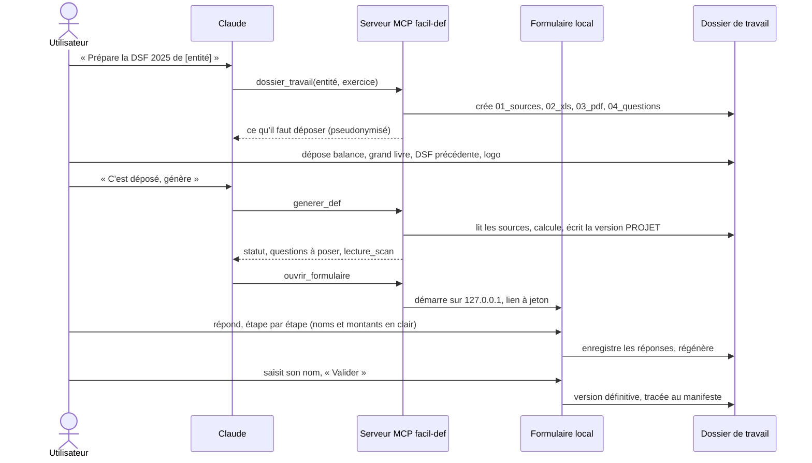
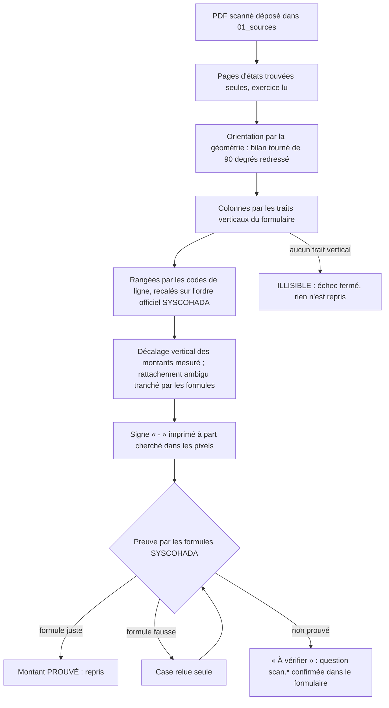
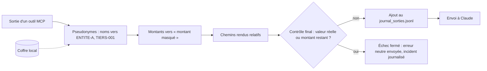
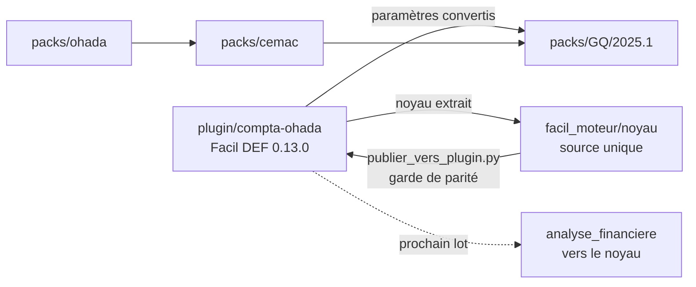

# Facil DEF — l'extension livrée

livrée · Version 0.13.0 · 20/10/2026

Facil DEF est une extension Claude Desktop (et un plugin Claude Code, `plugin/compta-ohada`) qui produit la
déclaration statistique et fiscale de Guinée équatoriale — la DSF, « DEF » en espagnol — au référentiel
SYSCOHADA révisé, à partir de la balance et du grand livre de l'entité. Les calculs, les fichiers et les
réponses restent sur le poste de l'utilisateur.

C'est aussi le **moteur métier de référence** de Facil Finance : la décision ADR 0005 le réutilise au lieu de
le réécrire (voir [section 10](#10-comment-facil-finance-le-reutilise)).

## 1. Ce que fait Facil DEF

Trois principes conduisent tout le parcours.

| Principe | Ce qu'il veut dire concrètement |
| --- | --- |
| **Automatique d'abord** | L'utilisateur dépose ses fichiers ; l'extension les reconnaît **par leur contenu**, pas par leur nom, calcule et produit une version **PROJET** complète, sans attendre de réponse. Seule une balance illisible ou ambiguë arrête avant le calcul, parce qu'un calcul fondé sur une mauvaise lecture fausserait tout le reste. |
| **Questions ensuite** | Tout ce que les fichiers ne disent pas (identité, faits qui changent l'impôt, réintégrations proposées, choix d'interprétation, montants scannés non prouvés) est regroupé en **un seul lot** de questions, chacune avec son effet. Les réponses sont réinjectées partout, dans les classeurs comme dans les PDF. |
| **Validation nominative** | La version définitive n'est produite que si aucune question obligatoire n'est ouverte et que les sources n'ont pas changé depuis la génération. Elle porte le nom de la personne qui valide ; Claude Desktop demande une confirmation explicite à chaque validation, et Claude n'invente jamais la réponse à une question obligatoire. |

Ce que l'extension n'appelle jamais « fait » sans preuve :

- une proposition de réintégration fiscale n'est **jamais appliquée sans acceptation** ;
- un choix d'interprétation différent de la lecture stricte de la loi est appliqué, mais **son écart est chiffré** au rapport ;
- un montant lu sur une DSF scannée n'est repris que s'il est **prouvé** par les formules SYSCOHADA (section 4) ;
- une version ne se valide jamais sur des fichiers qu'elle n'a pas lus : un fichier ajouté après la génération
  bloque la validation jusqu'à la régénération.

## 2. Parcours de l'utilisateur

Le parcours suit le manuel d'utilisation remis le 20/10/2026. Le serveur MCP impose l'ordre des outils :
`dossier_travail` → dépôt dans `01_sources` → `generer_def` → `questions_ouvertes` → `enregistrer_reponse` →
`generer_def` → `valider_version`.

Les étapes du formulaire local, dans l'ordre :

1. **Sources** — ce qui manque ; sans DSF précédente, deux réponses permises : premier exercice, ou DSF précédente indisponible ;
2. **Identité de l'entité** — saisie une fois, ou **proposée** avec son origine (fiche entité, validation précédente, page de garde de la DSF précédente) ; la forme juridique se choisit dans une liste ;
3. **Faits sur l'entreprise** — création récente, prestations de non-résidents, paiement par l'État ; chaque question cite son article ;
4. **Réintégrations fiscales (TF1)** — accepter ou refuser, avec l'effet sur l'impôt affiché ;
5. **Choix d'interprétation** (facultatif) — dont le modèle de la liasse : SYSCOHADA système normal par défaut, ou format GE ;
6. **Analyse financière** (facultatif) — causes des variations significatives ;
7. **Validation** — récapitulatif, régénération, puis validation nominative.

Le mode « préparer et valider » (« Prépare et valide la DSF 2025 de [entité], validée par [nom] ») suit le même
déroulé : Claude pose toutes les questions restantes dans un seul message, puis valide au nom donné après le clic
de confirmation.

## 3. Livrables produits

Chaque version est numérotée (v1, v2…) et n'écrase jamais la précédente. Les fichiers d'une version projet se
terminent par `_projet` et portent le filigrane « PROJET » ; ceux de la version définitive, non.

| Livrable | Contenu | Dossier | Usage |
| --- | --- | --- | --- |
| `DEF_…_SYSCOHADA_FR` | Liasse au modèle SYSCOHADA système normal, adaptée aux données (notes sans montant ni information omises et signalées), avec les tableaux fiscaux GE TF1 à TF5 | `02_xls`, `03_pdf` | À déposer après relecture et signature |
| `DEF_…_ES` | Version espagnole au format GE | `02_xls`, `03_pdf` | À déposer selon l'usage |
| `…_rapport_FR` / `_ES` | Rapport PDF de la DSF | `03_pdf` | Lecture, archivage |
| `…_annexe-balance_FR` / `_ES` | Balance annexée (art. 79.2) | `03_pdf` | Pièce jointe |
| `…_controle` | Contrôles, réponses appliquées (origine, date), valideur | `02_xls`, `03_pdf` | Interne, jamais déposé |
| `…_analyse-financiere` | Analyse pluriannuelle : états comparés, SIG, ratios, variations expliquées | `02_xls`, `03_pdf` | Interne, jamais déposé |
| `manifeste.json` | Empreintes des sources lues, réponses appliquées, livrables, statut, valideur | racine de l'exercice | Traçabilité |

Les classeurs portent des **formules vivantes** ; le rendu PDF se fait **sans Excel**, par un évaluateur de
formules embarqué (691/691 cellules identiques à Excel, mesuré en 0.9.0). Le format GE reste disponible au choix
dans l'étape « Choix d'interprétation ».

!!! warning "Ne pas retoucher les classeurs produits"
    On corrige une réponse puis on régénère : classeurs et PDF restent ainsi identiques.

## 4. Lecture des DSF scannées

Depuis 0.12.0, une DSF précédente **scannée** (PDF sans texte) est lue sur le poste par OCR local
(`ocr_def.py`, RapidOCR sur onnxruntime embarqué). Elle fournit le compte de résultat N-1 ; le bilan N-1 vient
toujours des soldes d'ouverture de la balance, avec un contrôle croisé.

**La règle de preuve.** Un chiffre lu n'est jamais pris tel quel. Il est confronté aux formules du référentiel :
actif = passif, sous-totaux du bilan, soldes du compte de résultat, résultat = CJ, brut − amortissements = net.

- Seuls les montants **prouvés** sont repris. Un signe incohérent peut être **déduit**, et il est alors marqué comme tel.
- **Jamais un chiffre calculé à la place d'un chiffre lu.**
- Deux colonnes collées, ou une formule `0 = 0`, ne prouvent rien.
- Les montants non prouvés se confirment dans le formulaire local. Ils ne se demandent jamais dans la conversation, où ils sont masqués.

La lecture tourne **en arrière-plan** et son résultat est **mis en cache**. `generer_def` en rend l'état
(`lecture_scan` : en cours, lue, échec) ; pendant la lecture, Claude invite à patienter, puis l'utilisateur régénère.

**Résultats mesurés**

| Mesure | Résultat |
| --- | --- |
| DSF réelle 2024 numérisée (non versionnée) | 48/48 formules justes ; 212 montants prouvés sur 254 |
| DSF réelle 2023 numérisée (non versionnée) | 49/50 formules justes |
| DSF synthétique scannée (`tests/fabriquer_scan.py`) | `test_ocr_def` 23/23, dont « tout montant prouvé est juste » |
| Falsification de l'OCR | 4 mutations sur 5 détectées au premier passage ; la 5ᵉ (« - » imprimé à part) a reçu un test ciblé, rejoué seul |
| Durée de lecture, poste du porteur | moins de 3 minutes constatées, pour une DSF de 44 pages |
| Durée de lecture, poste de développement | environ 12 min par DSF seule, 40 min sur un poste chargé |

L'écart de durée entre les deux postes n'est pas expliqué. Une tâche datée prévoit de le mesurer avant toute
optimisation (section 9).

## 5. Analyse financière pluriannuelle

Depuis 0.13.0, chaque version produit un **rapport d'analyse financière** interne, qui n'est jamais déposé
(`analyse_financiere.py`).

- **Années couvertes** : N (balance), N-1, puis les années des DSF précédentes, en Excel ou scannées. Chaque DSF
  scannée en apporte deux : son exercice et le précédent. Sur le dossier pilote, l'analyse couvre 2022 à 2025.
- **Ce qui entre** : seuls des montants **prouvés ou confirmés**. Un montant manquant s'affiche « — » et n'est jamais estimé.
- **Contenu** :
    - chiffres clés et tendance ;
    - bilan et compte de résultat comparés ;
    - soldes intermédiaires de gestion (chiffre d'affaires, marge commerciale, valeur ajoutée, EBE, résultats d'exploitation, financier, des activités ordinaires, hors activités ordinaires, résultat net) ;
    - 17 ratios, jamais calculés sur une base absente, nulle ou négative.
- **Variations significatives** : variation d'au moins 10 % **et** d'au moins 1 % du total du bilan (postes de
  bilan) ou du chiffre d'affaires (compte de résultat). Pour chacune, le rapport donne :
    - les **comptes qui portent l'écart** (au bilan : clôture − ouverture, compte par compte ; au compte de résultat : composition de l'exercice N) ;
    - des **points à vérifier** propres au poste : coupure, provisions, inventaire, rapprochements…
- **Cause métier** : jamais inventée. Elle est demandée en **question facultative** (`analyse.<code>`), puis
  reprise au rapport avec son origine et sa date.

Preuves : `test_analyse_financiere` 23/23, falsification 4/4 ; sur le dossier pilote réel, 16 variations expliquées.

!!! note "Limite déclarée"
    Sans les balances des années passées, l'écart n'est expliqué compte par compte que pour le bilan.

## 6. Confidentialité

Toute sortie du serveur MCP vers Claude passe par une passerelle (`serveur/confidentialite.py`).

| Claude voit | Claude ne voit pas |
| --- | --- |
| Des pseudonymes stables : `ENTITE-A`, `TIERS-001`, `IDENT-002`… | Les noms réels de l'entité, des tiers, de l'identité saisie (raison sociale, adresse, NIF, RCCM, dirigeant) |
| `[montant]` à la place de tout nombre de 5 chiffres ou plus, ou avec séparateurs de milliers | Les montants, les écritures, les soldes |
| Les années, les numéros de compte courts, les compteurs de questions | La table réel ↔ pseudonyme (le coffre, `.facil_coffre.json`, reste sur le poste) |
| Des chemins relatifs (`<Facil-DEF>\ENTITE-A\2025\…`) | Le contenu des fichiers du dossier `Facil-DEF` |

Dans l'autre sens, la passerelle rend leur valeur réelle aux pseudonymes que Claude renvoie (entité, identifiants
de question).

- **Échec fermé** : si une valeur réelle connue du coffre ou un montant subsiste après filtrage, la sortie n'est
  pas envoyée ; une erreur neutre part à sa place.
- **Journal** : chaque sortie transmise est ajoutée à `journal_sorties.jsonl`, à la racine du dossier de travail
  (horodatage, outil, empreinte, contenu). L'utilisateur peut vérifier après coup tout ce qui a quitté le poste.
- **Deux modes** : « stricte » par défaut ; « standard » via la case « Nom de l'entité en clair pour Claude ».
  En mode standard, seul le nom de l'entité reste lisible ; tiers, identité, montants et chemins restent protégés.
- **Formulaire local** : c'est là que noms et montants se lisent en clair, sans passer par la conversation. Ses protections :
    - écoute sur `127.0.0.1` seulement ;
    - jeton aléatoire exigé à chaque requête (puis cookie `HttpOnly`, `SameSite=Strict`) ;
    - en-têtes `Host` et `Origin` contrôlés ;
    - aucune ressource externe ;
    - deux horloges tenues par le serveur, **15 min d'inactivité et 12 h au plus**, avec un préavis d'une minute.

!!! warning "Ce que la passerelle ne protège pas"
    Elle ne filtre que le canal de l'extension. Ce que l'utilisateur écrit lui-même dans la conversation, ou un
    fichier qu'il y joint, part tel quel. Côté Claude Code, un hook empêche Claude de lire le dossier de travail.

## 7. Architecture technique

| Brique | Rôle | Source |
| --- | --- | --- |
| Runtime Python embarqué | Distribution officielle « embeddable » de python.org, 3.13.7, dépendances installées par `pip install --target` dans le runtime (jamais dans un Python global) | `plugin/compta-ohada/tools/construire_runtime.py` |
| Serveur MCP `facil-def` | 7 outils (`dossier_travail`, `lister_dossiers`, `generer_def`, `questions_ouvertes`, `enregistrer_reponse`, `valider_version`, `ouvrir_formulaire`), FastMCP, sortie standard réservée au canal | `plugin/compta-ohada/serveur/mcp_def.py` |
| Passerelle de confidentialité | Pseudonymes, masquage, contrôle final, journal | `plugin/compta-ohada/serveur/confidentialite.py` |
| Formulaire local | Réponses, régénération, validation hors conversation | `plugin/compta-ohada/serveur/formulaire.py` |
| Dossier de travail | Reconnaissance des sources, questions, versions projet / définitive, validation | `plugin/compta-ohada/skills/dsf-syscohada/scripts/espace_def.py` |
| Liasse | SYSCOHADA système normal par défaut (`def_modele.py`), format GE au choix (`def_ge.py`), TF1 à TF5 | `plugin/compta-ohada/skills/dsf-syscohada/scripts/` |
| Contrôles | Rapport de contrôle de la version | `plugin/compta-ohada/skills/dsf-syscohada/scripts/controle_def.py` |
| OCR et analyse | `ocr_def.py`, `analyse_financiere.py` | `plugin/compta-ohada/skills/dsf-syscohada/scripts/` |

Points d'exploitation à connaître :

- **Préchargement des DLL natives.** Sous Windows, une DLL chargée dans un outil MCP pendant qu'un autre fil
  attend sur le tube d'entrée peut se figer à son initialisation. Constat du 19/10/2026 : `numpy`, importé par
  `openpyxl`, bloquait `generer_def` indéfiniment, à 0 % de CPU. Correctif : `precharger()` importe `numpy`,
  `openpyxl` et `pymupdf` **avant** `mcp.run()`. Pour un diagnostic, la variable `FACIL_DIAG_PILE` écrit la pile
  de tous les fils chaque minute.
- **Garde d'empaquetage.** `tools/package.py` refuse d'empaqueter dans trois cas :
    - une valeur de la liste des noms confidentiels (tenue **hors plugin**) figure dans un fichier ou un classeur du plugin ;
    - une copie de `lib/` diverge ;
    - un test échoue.
- **Paquet livré** : `dist/facil-def.mcpb`, environ 190 Mo (runtime d'environ 440 Mo avec le moteur OCR) ;
  `test_mcp_def` 15/15 rejoué sur le contenu exact de l'extension empaquetée.
- **Réglages de l'extension** : dossier de travail (vide : `Documents\Facil-DEF`, ou `%USERPROFILE%\Facil-DEF`
  si les Documents sont synchronisés par OneDrive) et nom de l'entité en clair (désactivé par défaut).

## 8. Historique des versions

| Version | Date | Apport |
| --- | --- | --- |
| 0.10.0 | 01/10/2026 | Production sans DSF déposée : liasse SYSCOHADA système normal par défaut, balance et/ou grand livre, formulaire par étapes, passerelle de confidentialité, Python embarqué |
| 0.10.1 – 0.10.3 | 16-17/10/2026 | Dossier par défaut robuste ; fin de la page blanche du formulaire (politique de référent) |
| 0.11.0 | 17/10/2026 | DSF déposée après génération signalée ; identité reprise des sources ; mode « préparer et valider » |
| 0.11.1 | 18/10/2026 | DSF précédente en PDF reconnue, scannée ou texte |
| 0.12.0 | 19/10/2026 | DSF précédente scannée lue sur le poste, preuve par les formules, lecture en arrière-plan, DLL préchargées |
| 0.13.0 | 19/10/2026 | Rapport d'analyse financière pluriannuel : SIG, ratios, variations expliquées par les comptes |

## 9. Limites déclarées et tâches ouvertes

**Limites déclarées**

- **Formulaire sans traits verticaux de colonnes** : ses montants sont déclarés illisibles et ne sont pas lus (échec fermé).
- **Écart d'une unité** entre total actif et total passif, constaté sur la DSF 2023 : les montants concernés restent « à vérifier ».
- **Extension non signée** : la signature exige un certificat de l'éditeur (`mcpb sign`).
- **Interface encore en « DEF » en français** : boutons et options disent « DEF ». Un passage à « DSF » est proposé
  en 0.13.1, suivi de nouvelles captures du manuel ; la décision du porteur est attendue.
- **Analyse financière** : sans balances des années passées, l'écart par compte n'est expliqué que pour le bilan.
- **Éclatement au niveau du compte seulement** : les avances fournisseurs tiers par tiers exigent la balance auxiliaire.
- **Données extra-comptables à saisir** : effectifs (27B), fiches R1 à R3, notes 35-36.
- **TF4 nominatif** : il requiert le fichier de paie.

**Non vérifié** : l'installation de la version 0.12.0 sur le poste du porteur. La version 0.13.0, elle, y est
installée et a servi aux captures du manuel.

**Tâches datées**

| Date | Tâche |
| --- | --- |
| 2026-10-20 | Lire aussi la page de garde des DSF scannées (identité), avec l'OCR déjà en place |
| 2026-10-20 | Mesurer la durée de lecture des scans sur les deux postes, puis l'accélérer |
| 2026-10-21 | Garde de délai dans `test_mcp_def` : un gel du serveur fait aujourd'hui pendre le test au lieu de le faire échouer |
| — | Inchangées : L10 (notes absentes du formulaire), L5 (banc sur dossiers réels), effectifs 27B |

**Prochain geste** : attendre le retour du porteur sur le rapport d'analyse, puis exploiter les balances des
années passées si elles sont fournies.

## 10. Comment Facil Finance le réutilise

L'ADR 0005 a tranché : Facil Finance **réutilise** le moteur de Facil DEF, il ne le réécrit pas.

- **Noyau extrait** : la lecture des balances et des grands livres, l'évaluation des formules Excel et le rendu PDF
  vivent désormais dans `facil_moteur/noyau/`, source unique **sans règle de pays**. Ils sont publiés vers le
  plugin par `outils/publier_vers_plugin.py` ; une garde de parité rougit si la copie du plugin diverge. Le noyau
  se corrige dans `facil_moteur/noyau/`, jamais dans le plugin.
- **Pack GQ converti depuis le plugin** : les paramètres fiscaux et le formulaire de Guinée équatoriale sont devenus
  le pack `GQ/2025.1`. Il est résolu par couches OHADA ← CEMAC ← pays, et `facil_moteur/adaptateurs.py` rend ces
  paramètres aux calculs nationaux encore portés par le plugin.
- **Prochain lot** : extraire `analyse_financiere.py` dans le noyau, pour que l'analyse pluriannuelle serve à tous
  les pays et pas seulement à la Guinée équatoriale.
