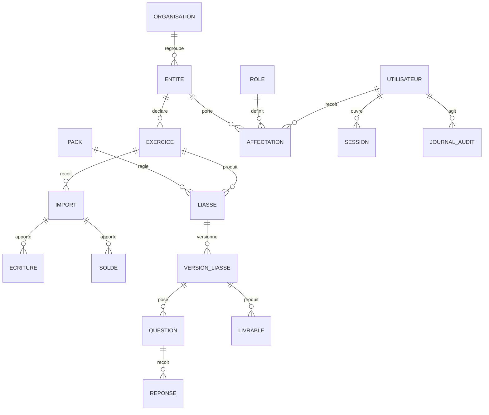

# Modèle de données cible

cible · Version 0.1 · 20/10/2026

Point de départ du **premier jour du sprint 2** (EX-IMP-4, EX-PLAT-2) : schéma de la base, écritures immuables, versions, droits, audit. Il s'arrête dans une migration Alembic relue ; tout écart à cette page se reporte ici dans la même demande de fusion.

## 1. Entités

| Entité | Rôle | Particularité |
|---|---|---|
| `organisation` | Cabinet (édition installée) ou client (SaaS) | Clé de la sécurité au niveau des lignes |
| `entite` | Société déclarante : raison sociale, NIF, pays, forme juridique | Forme juridique et pays **choisis dans une liste** dérivée du pack |
| `exercice` | Entité × période : ouverture, clôture, état (`ouvert`, `clos`) | Un exercice clos refuse les imports |
| `import` | Un fichier reçu : empreinte SHA-256, format détecté, auteur, horodatage | **Unique** par (exercice, empreinte) : rejouer un import ne duplique rien |
| `ecriture`, `solde` | Lignes du grand livre et de la balance importées | **Ajout seul** : déclencheurs qui refusent `UPDATE` et `DELETE` |
| `pack` | Pays, version, date d'entrée en vigueur, signature Ed25519 | Le pack en vigueur à la date de clôture est résolu, jamais choisi à la main |
| `liasse` | Exercice × pack × modèle (SYSCOHADA système normal, format national) | — |
| `version_liasse` | n°, statut `projet` / `definitive`, empreintes des sources lues, valideur | Une version **définitive** est figée ; corriger crée la version n+1 |
| `question`, `reponse` | Questions que les fichiers ne tranchent pas ; réponses historisées | Une réponse garde son **origine** : saisie, reprise, proposition acceptée |
| `livrable` | Fichiers produits par version (Excel, PDF), empreinte | — |
| `utilisateur`, `role`, `affectation` | Identité et droits **métier** par entité | Les droits vivent ici, jamais dans le fournisseur d'identité (ADR 0010) |
| `session` | Dernière activité, ouverture | Deux horloges : inactivité 15 min, durée absolue 12 h |
| `journal_audit` | Acteur, action, objet, empreinte précédente | **Chaîné** : une ligne retirée se voit |

## 2. Invariants tenus par la base

| Invariant | Mécanisme | Preuve attendue (sprint 2) |
|---|---|---|
| Les écritures importées ne changent jamais | déclencheurs `BEFORE UPDATE OR DELETE` qui lèvent une erreur | un `UPDATE` direct en SQL échoue |
| Une version définitive ne change jamais | même mécanisme, sur `statut = 'definitive'` | idem |
| Un utilisateur ne voit que son organisation | sécurité au niveau des lignes (`ALTER TABLE … ENABLE ROW LEVEL SECURITY`), paramètre de session `app.organisation` | une requête sans le paramètre ne rend **aucune** ligne |
| Un import rejoué ne duplique rien | contrainte unique (exercice, empreinte) | deux dépôts du même fichier → une ligne |
| Le journal ne se réécrit pas | chaînage par empreinte + ajout seul | une ligne supprimée casse la chaîne, détectée par la vérification |
| Une version définitive a un valideur nommé | `CHECK (statut <> 'definitive' OR validee_par IS NOT NULL)` | insertion refusée sinon |

## 3. Index et volumes

Le grand livre croît avec la clientèle : chaque lecture est **bornée** et chaque filtre **indexé**.

| Requête | Index |
|---|---|
| Écritures d'un exercice par compte | `ecriture (import_id, compte)` ; `import (exercice_id)` |
| Soldes d'un exercice | `solde (import_id, compte)` |
| Dernière version d'une liasse | `version_liasse (liasse_id, numero DESC)` |
| Journal d'une entité par date | `journal_audit (organisation_id, horodatage DESC)` |
| Sessions actives | `session (utilisateur_id, derniere_activite)` |

Ordre de grandeur à mesurer en durcissement (`EXPLAIN (ANALYZE, BUFFERS)`) : 500 000 écritures par exercice pour une entité importante.

## 4. Cycle de vie

| Question | Réponse retenue |
|---|---|
| Qui crée une liasse ? | un utilisateur ayant le droit `produire` sur l'entité |
| Se corrige-t-elle ? | par **remplacement** : version n+1 ; la n reste lisible |
| Que devient la référence connue de l'usager ? | le numéro de version est stable ; la « dernière » se désigne explicitement |
| Se suspend-elle ? | un exercice peut être rouvert (droit `administrer`, motif obligatoire, tracé) |
| Où lire son état et son historique ? | versions, réponses et journal d'audit, affichés dans la fiche |
| Rejeu, échec à mi-chemin ? | génération idempotente, en transaction ; un échec laisse la version précédente intacte |
| Donnée à l'état final ? | conservation légale (10 ans en général, à confirmer par pays) ; purge par exercice, tracée |
| Quels droits ? | `lire`, `importer`, `produire`, `repondre`, `valider`, `administrer` par entité ; aucun par défaut |

## 5. Ce qui reste à décider en sprint 2

- Grain du stockage des écritures (une table, ou partitionnement par exercice) : à trancher après mesure.
- Conservation par pays : durée légale de chaque État, à inscrire dans le pack.
- Chiffrement au repos des champs identifiants (NIF) : à évaluer avec la sauvegarde et la restauration.
