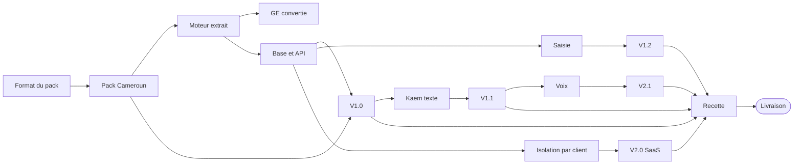

# Plan de versions — V1.0 à V2.1, livraison en {{cal:mois:livraison}}

validé · Version 1.0 · 15/10/2026 · Validé par le porteur ; mis à jour au fil de l'avancement · Décision du porteur : **implémentation en 1 mois, codée avec Claude Code, livraison le {{cal:jalon-long:livraison}}**

!!! abstract "Ce que « livré » veut dire ici"
    Le **code** des cinq versions est écrit, testé et empaqueté en un mois, avec Claude Code ([ADR 0013](../adr/0013-developpement-avec-claude-code.md)).

    Une version n'est **disponible commercialement** qu'une fois ses **preuves externes** obtenues : validation d'un pack par un expert local et des liasses réelles, audit de sécurité, contrats. Claude Code ne compresse pas ces preuves.

    Chaque version a donc deux dates : celle du code, et celle de la disponibilité.

!!! info "Les packs pays ne suivent pas les versions du logiciel"
    Un pays devient disponible quand son pack est validé, selon la [roadmap](roadmap.md), et pas quand une version du logiciel est livrée. Le logiciel livré le {{cal:jalon-long:livraison}} sait déjà produire n'importe quel pays ; ce qui manque, pays par pays, c'est le pack validé.

## 1. Les cinq versions

| Version | Promesse | Contenu | Code terminé | Statut à la livraison | Preuve externe restante (échéance) |
|---|---|---|---|---|---|
| **V1.0 — Socle** | « Ma liasse, juste et prouvée, à partir de ma balance » | Moteur extrait ; format de pack ; packs GE, Cameroun, Sénégal (SN + SMT) ; grand livre en base ; sociétés, exercices, droits ; versions PROJET et DÉFINITIVE ; sessions ; installeurs Windows et Linux ; mode SSH ; sauvegardes ; licence hors ligne ; interface FR, ES, PT, EN | {{cal:jalon:v10}} | **Disponible** pour la GE (pack validé sur le dossier pilote). **Préversion** pour le Cameroun et le Sénégal | 10 liasses réelles reproduites par pays ({{cal:preuve:packs_cm_sn_10_liasses}}), revues par l'expertise de Claude d'après les textes officiels (décision D9) ; **signature d'un expert-comptable inscrit à l'ordre du pays avant toute vente** (R14) ; 30 avant publication définitive |
| **V1.1 — Kaem (texte)** | « Je demande, Kaem prépare et m'explique » | Paquet IA (Gemma 4 E4B, llama.cpp) ; catalogue de commandes ; chat ; palette ; explications d'écarts ; brouillons de notes ; journal | {{cal:jalon:v11}} | **Disponible** si le banc passe sur les 3 PC de référence, sinon **préversion** | Banc métier ≥ 90 % (pendant la recette, {{cal:periode:recette}}) |
| **V1.2 — Production complète** | « Je tiens ma comptabilité dans Facil Finance » | Saisie dans le même grand livre ; lettrage ; clôtures ; TVA ; OCR avec validation humaine ; analyse des écritures ; reporting du dirigeant ; télédéclaration (format SEN ETAFI d'abord) | {{cal:jalon:v12}} | **Préversion** | Un mois réel saisi et certifié par un comptable pilote ({{cal:preuve:v12_mois_certifie}}) ; corpus OCR ≥ 90 % |
| **V2.0 — SaaS** | « Facil Finance sans serveur à gérer » | Multi-clients (isolation au niveau des lignes, une clé par client) ; Keycloak ; souscription et facturation ; console d'exploitation ; migration aller-retour depuis l'édition installée | {{cal:jalon:v20}} | **Préversion** : aucune donnée réelle avant l'audit | Audit de sécurité externe ({{cal:preuve:audit_securite}}) ; hébergement régional contractualisé ; contrat SaaS et accord de traitement des données ({{cal:preuve:contrats_juriste}}) |
| **V2.1 — Kaem (voix) et veille** | « Je parle à Kaem ; elle me prévient » | Écoute (Gemma 4) ; voix féminine (Kokoro) en FR, ES et PT ; alertes d'échéances et d'anomalies ; mot d'éveil en option | {{cal:jalon:v21}} | **Préversion** | Banc vocal sur 100 phrases par langue ({{cal:preuve:banc_vocal}}) ; consentement du micro validé par le juriste |

## 2. Calendrier — un mois de codage, une semaine de recette

{{cal:gantt}}

Le détail jour par jour est dans le [plan de sprints](sprints.md) ; la suite, après la livraison, est dans la [roadmap](roadmap.md).

## 3. Pourquoi ce calendrier tient, et à quelles conditions

| Condition | Pourquoi | Si elle manque |
|---|---|---|
| **Claude Code écrit le code ; un humain le relit** chaque jour | Le goulet n'est plus l'écriture, c'est la relecture et la preuve | Un jour de relecture perdu = un jour de retard ; on ne fusionne jamais sans relecture |
| **Les gardes et contre-épreuves tournent à chaque fusion** | Elles remplacent la vérification manuelle que permettait un rythme lent | On ne livre pas une version dont une garde n'a pas été falsifiée |
| **Le porteur arbitre en moins de 24 h** | Cinq versions en un mois ne laissent aucune semaine d'attente | La tâche bloquée passe à la version suivante, avec une date |
| **L'expert-comptable du Cameroun est disponible dès le sprint 1** ({{cal:periode:s1}}) | Le pack étalon fixe le format pour tous les pays | Le format est validé sur la GE seule ; risque de refonte (R1) |
| **3 PC de référence (sans GPU, 16 Go) sont disponibles au sprint 3** ({{cal:periode:s3}}) | Le banc de Kaem en dépend | V1.1 sort en préversion |

## 4. Dépendances critiques

