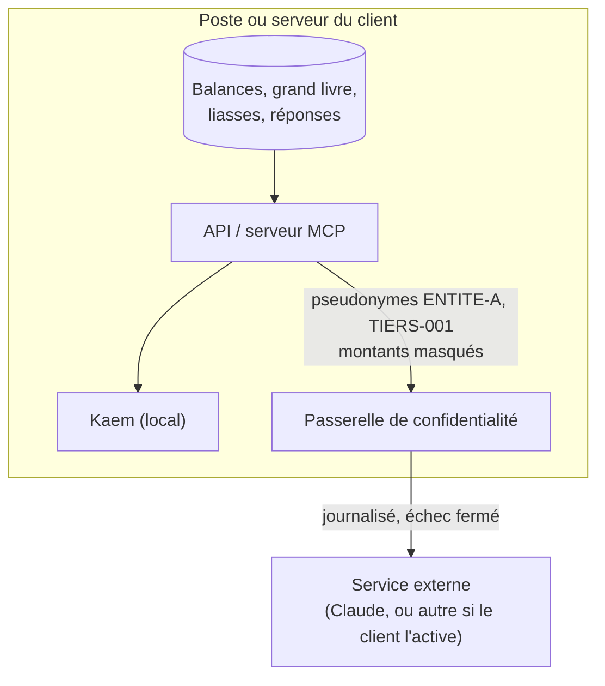

# Sécurité et confidentialité

brouillon · Version 0.1 · 20/10/2026

Facil Finance manipule les comptes des entreprises : balances, résultats, identifiants fiscaux. Cette page dit ce qui les protège, **dans le produit** et **dans le dépôt public**, et ce qui reste à prouver.

## 1. Dans le produit

| Mesure | Où | Exigence |
|---|---|---|
| Calcul local, aucune IA externe par défaut | Kaem local ; Facil DEF : la conversation ne reçoit que des pseudonymes | ADR 0007, ADR 0008 |
| Passerelle : pseudonymes, montants masqués, journal des sorties, échec fermé | `plugin/compta-ohada/serveur/confidentialite.py` ; serveur Facil Finance (V1) | EX-IA |
| Sessions à deux horloges, tenues par le serveur | inactivité 15 min, durée absolue 12 h, préavis d'une minute | EX-PLAT-4 |
| Droits tenus par la base | sécurité au niveau des lignes PostgreSQL | EX-PLAT-3 |
| Rien n'est écrasé ; audit chaîné | écritures et versions en ajout seul | EX-IMP-4 |
| Mots de passe | NIST SP 800-63B : longueur, pas de composition imposée, pas de rotation forcée ; TOTP | ADR 0010 |
| Packs pays signés | Ed25519, vérifiés au chargement ; clé privée hors dépôt | ADR 0006 |
| Formulaire local de Facil DEF | `127.0.0.1`, jeton, en-têtes de sécurité éprouvés en navigateur réel | — |

## 2. Dans le dépôt public

Le dépôt est **public** (licence propriétaire, ADR 0011). Aucune donnée de client n'y entre.

| Barrière | Ce qu'elle arrête |
|---|---|
| `.gitignore` | `datas/`, dossiers de travail `Facil-DEF`, extension construite, captures non masquées, clés |
| `outils/purger_classeur.py` | liaisons externes d'un classeur et leurs valeurs en cache, noms définis cachés, auteurs et société des propriétés |
| `outils/garde_confidentialite.py` | noms confidentiels (empreintes HMAC), courriels, IBAN, téléphones |
| gitleaks (CI) | jetons et secrets |
| Formulaires de tickets | rappel : jamais de donnée réelle, un exemple se fabrique |

!!! info "Pourquoi des empreintes HMAC, et pas la liste"
    La liste des noms à protéger nomme les clients : la publier serait la fuite qu'elle prévient. Le dépôt ne porte que `HMAC-SHA256(clé, nom normalisé)`. Sans la clé, on ne peut ni lire les noms ni **tester une hypothèse** (« tel client y figure-t-il ? »), ce qu'une empreinte simple permettrait. La clé vit en secret de CI et sur le poste de l'éditeur.

!!! warning "Constat du 20/10/2026"
    Le gabarit officiel de la DSF de Guinée équatoriale portait **125 liaisons externes** vers d'autres classeurs ; leur cache contenait des noms de personnes et un numéro de compte bancaire, sans qu'aucune cellule ne s'en serve. Aucune garde ne le voyait : les gardes lisaient les cellules, pas les parties cachées de l'archive. Le gabarit a été purgé avant la première publication, toutes les gardes du plugin rejouées, et `purger_classeur.py --verifier` est désormais exigé en CI sur chaque classeur.

## 3. Signaler une vulnérabilité

Jamais dans un ticket public : [SECURITY.md](https://github.com/KouemouSah/Facil_Finance/blob/develop/SECURITY.md) (signalement privé GitHub, ou sah@emacsah.com).

## 4. Ce qui reste à prouver

| Point | Échéance |
|---|---|
| Revue OWASP ASVS niveau 2 en autocontrôle, OWASP API Top 10 | Durcissement (sprint 5) |
| Signature de l'extension Facil DEF | avant diffusion large |
| Clé de **production** de signature des packs | avant la recette |
| Mesures de performance sur volumes réalistes (`EXPLAIN ANALYZE`) | Durcissement |
