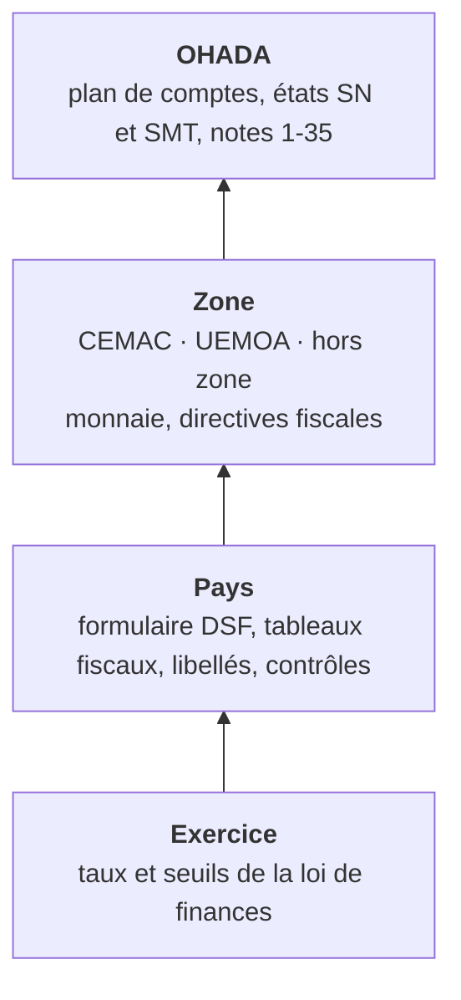

# Format du pack pays

<span class="statut statut--brouillon">brouillon</span> · Version 0.1 · 15/10/2026 · Valable pour toutes les versions (V1.0 à V2.1)

!!! abstract "Objet"
    Ce document décrit **tout ce qui dépend d'un pays**. C'est le contrat entre le moteur, qui ne connaît aucun pays, et les données qui décrivent une liasse nationale ([ADR 0006](../adr/0006-packs-pays-declaratifs.md)). Le pack Cameroun en est le premier client ; la Guinée équatoriale sera ensuite convertie dans ce format.

## 1. Couches et résolution



Le moteur choisit le pack ainsi :

1. Il prend **le pays et la date de clôture** de l'exercice.
2. Il cherche la version de pack en vigueur à cette date (`valide_du` ≤ clôture ≤ `valide_au`).
3. Il fusionne les couches : **chaque couche supérieure remplace une valeur de même clé**. Chaque surcharge est tracée dans le rapport de production.
4. Il refuse un pack non signé, expiré pour la date demandée ou au statut `brouillon`, sauf en mode *atelier* réservé à l'équipe Facil.

**Une liasse ancienne se reproduit toujours avec le pack de son exercice.** Un pack retiré n'est plus proposé pour les nouveaux exercices, mais il reste lisible et rejouable pour ceux qu'il a servis.

## 2. Arborescence

```text
packs/
└─ CM/                                  # code pays ISO 3166-1 alpha-2
   └─ 2025.1/                           # version : <exercice de première validité>.<révision>
      ├─ pack.yaml                      # manifeste (§ 3)
      ├─ gabarits/
      │  ├─ sn.xlsx                     # formulaire officiel vierge, système normal
      │  └─ smt.xlsx                    # formulaire officiel vierge, système minimal
      ├─ structure/
      │  ├─ sn.json                     # feuilles, lignes, références (REF), zones à remplir
      │  └─ smt.json
      ├─ correspondances/
      │  ├─ sn.json                     # ligne → comptes (§ 4)
      │  └─ smt.json
      ├─ fiscal/
      │  └─ parametres.json             # taux, seuils, barèmes — chacun avec son article (§ 5)
      ├─ libelles/
      │  ├─ fr.json                     # libellés officiels ; en.json pour le Cameroun
      │  └─ …
      ├─ controles.json                 # contrôles propres au pays (§ 6)
      ├─ declencheurs.json              # quand une note extra-comptable est exigée
      ├─ tests/                         # cas de référence anonymisés (§ 7)
      ├─ SOURCES.md                     # textes officiels : URL, date, article
      ├─ CHANGELOG.md
      └─ SIGNATURE                      # signature Ed25519 de l'empreinte de chaque fichier
```

## 3. Manifeste `pack.yaml`

```yaml
pays: CM                       # ISO 3166-1 alpha-2, choisi dans une liste, jamais saisi
zone: CEMAC
monnaie: XAF                   # ISO 4217
langues_liasse: [fr, en]
systemes: [SN, SMT]
version: "2025.1"
valide_du: 2025-01-01          # dates de clôture couvertes
valide_au: null                # ouvert jusqu'au pack suivant
herite_de: [ohada/2017.1, cemac/2025.1]
statut: brouillon              # brouillon → valide → publie → retire
validation:
  expert: null                 # nom et ordre professionnel de l'expert local
  date: null
  liasses_reproduites: 0       # sur le banc (§ 7)
moteur_minimal: "1.0"          # version du moteur requise
```

| Statut | Proposé pour un nouvel exercice | Rejouable | Qui le fait passer à ce statut |
|---|---|---|---|
| brouillon | non (sauf en mode atelier) | oui | l'équipe Facil |
| valide | non | oui | l'expert local, avec le banc vert |
| publie | **oui** | oui | Facil, à la signature |
| retire | non | **oui** | Facil, en indiquant le motif et le pack qui le remplace |

## 4. Correspondances ligne → comptes

```json
{
  "ligne": "BI",
  "libelle_ref": "Clients",
  "comptes": [
    {"prefixe": "411", "solde": "debiteur"},
    {"prefixe": "416", "solde": "debiteur"},
    {"prefixe": "491", "colonne": "depreciation"}
  ],
  "exclure": ["4119"],
  "note": "17",
  "source": "SYSCOHADA révisé, guide d'application, ch. bilan"
}
```

**Règles** :
- un compte n'alimente **qu'une seule ligne** pour un sens de solde donné ; une garde le vérifie ;
- un compte de la balance qui n'est dans aucune correspondance va à la ligne « Autres… » du poste, **et l'écart est déclaré** ;
- les colonnes brut, amortissement et net sont dérivées, jamais saisies.

## 5. Paramètres fiscaux

```json
{
  "cle": "is.taux_normal",
  "valeur": 0.33,
  "unite": "taux",
  "valide_du": "2025-01-01",
  "article": "CGI Cameroun, art. 17",
  "source": "Loi de finances 2025",
  "url": "https://www.impots.cm/…",
  "consulte_le": "2026-10-15"
}
```

**Aucun taux sans article.** Un paramètre dont l'article est vide fait échouer la validation du pack. Les valeurs de l'exemple ci-dessus sont fictives : elles illustrent le format.

## 6. Contrôles

Les contrôles **communs à l'OHADA** (actif = passif, résultat du compte de résultat = résultat du bilan, note = poste, flux de trésorerie réconciliés) vivent dans la couche OHADA. Les contrôles propres au pays sont déclarés ainsi :

```json
{"id": "CM-TF-01", "expression": "TF1.resultat_fiscal >= TF1.minimum_perception", "gravite": "bloquant",
 "message": {"fr": "…", "en": "…"}}
```

## 7. Cas de référence et validation

- **Au moins 10 liasses réelles déposées** par pays, puis 30 avant la publication : on part de la balance et l'on doit retrouver la liasse au franc près, ou avec des écarts **tous expliqués**.
- Les cas sont **anonymisés** avant d'entrer dans le pack : aucun nom, aucun NIF, montants conservés. Les originaux restent hors du produit.
- Chaque garde du pack est validée par une contre-épreuve : on y introduit volontairement une erreur, et elle doit la détecter.

## 8. Précisions apportées par l'implémentation (sprint 1, v0.1)

L'implémentation (`facil_moteur.packs`, dépôt `facil-finance`) a précisé le format sur six points :

| Point | Précision |
|---|---|
| Sens du solde | Une règle porte `sens` : `tous`, `debiteur` ou `crediteur`. Une règle propre à un sens prime sur `tous` ; le plus long préfixe gagne |
| Exclusion des états | Un compte peut n'aller dans aucun état (classe 9), mais **seulement de façon explicite** : `ref: null` et `nature: hors_etats`. Sans cela, la règle est une erreur |
| Feuilles nationales | Le gabarit SN commun vient de la DGI du Cameroun. La couche OHADA déclare le motif de ses feuilles **nationales** (`gabarit_sn.feuilles_nationales`) ; un pack pays les garde (`feuilles_conservees`) ou le producteur les retire |
| Mentions d'en-tête | Les mentions du formulaire (République, ministère, administration) sont des **libellés du pays** (`entete.*`), et non des constantes du code |
| Sections fiscales | `fiscal/parametres.json` porte, à côté de `parametres`, les sections que le calcul national utilise (interprétations, racines de comptes, faits, propositions) et une section `non_confirme` |
| Statuts et preuves | La validation **exige** : un expert signataire et 10 liasses reproduites pour `valide`, 30 pour `publie`, `remplace_par` pour `retire`, et la signature dès qu'un pack quitte le brouillon |

## 9. Ce que chaque version ajoute au format

| Version | Ajout |
|---|---|
| V1.0 | Format ci-dessus ; outil interne d'édition et de validation des packs ; packs GE, CM et SN (Sénégal) |
| V1.1 | `kaem.json` : glossaire et formulations propres au pays, que Kaem utilise pour expliquer et citer |
| V1.2 | `teledeclaration.json` : format d'échange avec la plateforme nationale quand elle existe (SEN ETAFI, E-Liasse…) ; `tva.json` : déclarations périodiques |
| V2.0 | Distribution des packs par le canal SaaS ; un client peut **épingler** une version de pack pour un exercice |
| V2.1 | Lexique vocal par pays (prononciation des sigles, des comptes et des montants) |
